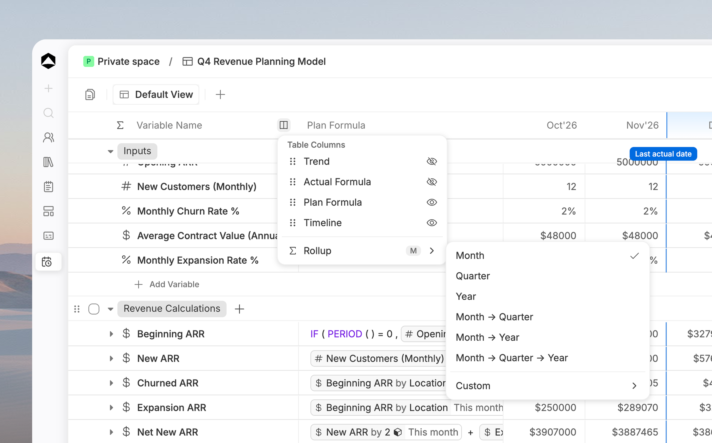
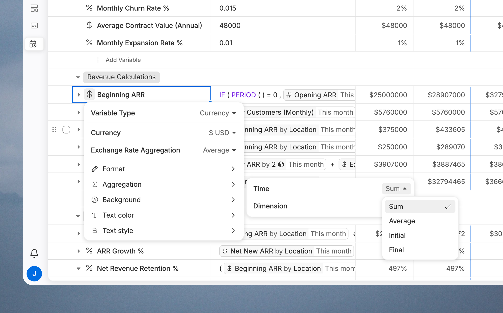

When you review a monthly model by quarter or year, two separate settings decide what you see. **Time rollups** decide which periods group together. **Time aggregation** decides what value represents each group. For example, a rollup groups January, February, and March into Q1. Aggregation decides whether Q1 revenue is the sum of those months and whether Q1 headcount is the March value.

## Time rollups

A time rollup adds higher-level period columns to a view. You choose rollups from **Roll up** in the view toolbar, or from **Rollup** in the **Table Columns** menu next to the variable name header. Each view keeps its own rollup choice, so two views of one model can show different groupings.

For a monthly model, the options are:

<Frame caption="Rollup options in the Table Columns menu">
  
</Frame>

| Option | What the view shows |
| --- | --- |
| **Month** | Monthly columns only, with no rollup |
| **Quarter** | Quarter columns only |
| **Year** | Year columns only |
| **Month → Quarter** | Monthly columns plus quarter columns |
| **Month → Year** | Monthly columns plus year columns |
| **Month → Quarter → Year** | Monthly columns plus quarter and year columns |

A quarterly model can roll up to years. A yearly model has no coarser period to roll up to. If the model uses a fiscal year, quarters and years follow it.

## Time aggregation

Time aggregation is a property of each variable. It tells Oculon how to turn several period values into one rollup value. You set it from the variable's formatting options, under **Aggregation** → **Time**. The variable detail panel shows the same setting as **Rollup/Aggregation**.

<Frame caption="Setting time aggregation for a variable">
  
</Frame>

| Option | Rollup value | Typical metrics |
| --- | --- | --- |
| **Sum** | The total of the grouped periods | Revenue, expenses, units sold |
| **Average** | The average of the grouped periods | Average price, utilization rate |
| **Initial** | The value of the first period in the group | Opening balance, opening ARR |
| **Final** | The value of the last period in the group | Headcount, cash balance, ending ARR |

Rollup columns use each variable's own time aggregation. One rollup can sum revenue and show the final headcount in the same quarter column.

The same menu also has a **Dimension** setting. It controls how values combine across dimension values, not across time. See [Variable breakdown](/concepts/data-and-structure/variables/variable-breakdown).

## Choose the right aggregation

Match the aggregation to what the metric means:

- **Flow metrics** build up over a period, such as revenue or expenses. Use **Sum**.
- **Balance metrics** describe a point in time, such as headcount or cash. Use **Final**, or **Initial** for an opening balance.
- **Rates and percentages**, such as gross margin %, shouldn't be summed. **Average** gives a simple average of the period rates. If you need a rate based on the grouped totals, calculate it from the summed components and compare.

If you can't explain a quarter value in one sentence, check the aggregation.

## Troubleshoot a wrong quarter or year value

1. Confirm what the metric means: flow, balance, or rate.
2. Check the variable's time aggregation.
3. Check the view's rollup and whether the model uses a fiscal year.
4. Check whether the group spans the Last actual date. Its periods may mix actual and planned formulas.
5. Check filters applied in the view.

## Related

- [Time granularity](/concepts/data-and-structure/time/time-granularity)
- [Views](/concepts/analysis-and-reporting/views)
- [Variable breakdown](/concepts/data-and-structure/variables/variable-breakdown)
- [Time in Oculon](/concepts/data-and-structure/time/time-in-oculon)
- [Time best practices](/concepts/data-and-structure/time/time-best-practices)
