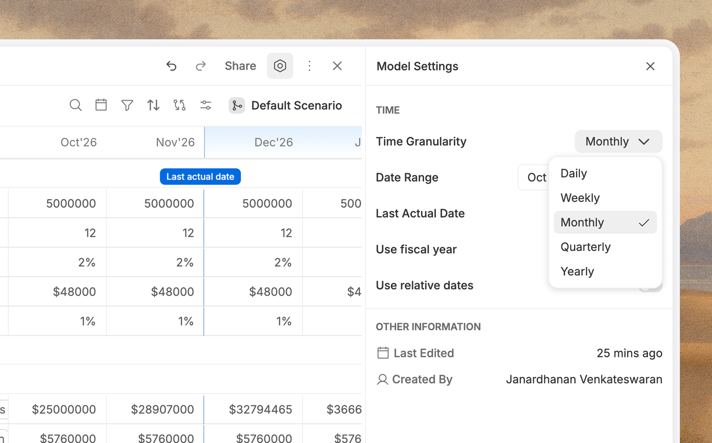

Time granularity is the length of each period in a model. A monthly model has one column per month. A quarterly model has one column per quarter. A yearly model has one column per year.

<Frame caption="The Time Granularity setting in Model Settings">
  
</Frame>

## Supported granularities

- **Monthly**: suits most operating plans, rolling forecasts, and monthly close.
- **Quarterly**: suits plans your team reviews and updates by quarter.
- **Yearly**: suits long-range plans and target setting.

You set granularity in the **Time Granularity** field in the **TIME** section of **Model Settings**. New models start with the workspace **Default Forecast Frequency**, which labels the yearly option **Annual**.

## How to choose

Choose the most detailed level your team reviews and updates. Ask:

- Do you close and review results every month?
- Do formulas depend on seasonality or month-end timing?
- Do you need month-by-month actual-versus-plan analysis?

If you answer yes to most of these, use monthly. If the model is mainly strategic, quarterly or yearly can keep it smaller.

A finer granularity doesn't stop you from reporting at a higher level. A monthly model can still show quarter and year columns through [time rollups](/concepts/data-and-structure/time/time-aggregation#time-rollups).

## How granularity affects other time settings

- The **Last actual date** and **Date Range** pick whole periods at the model's granularity.
- [Relative time](/concepts/data-and-structure/time/relative-time) references step one period at a time.
- Rollups can only group into coarser periods. A monthly model can roll up to quarters and years. A quarterly model can roll up to years.

## Change granularity carefully

Changing granularity changes every period in the model. Formulas, saved date ranges, views, and boards that depend on those periods may need a review. Decide on granularity before you build deep logic.

## Related

- [Time in Oculon](/concepts/data-and-structure/time/time-in-oculon)
- [Time rollups and aggregation](/concepts/data-and-structure/time/time-aggregation)
- [Relative time](/concepts/data-and-structure/time/relative-time)
- [Time best practices](/concepts/data-and-structure/time/time-best-practices)
