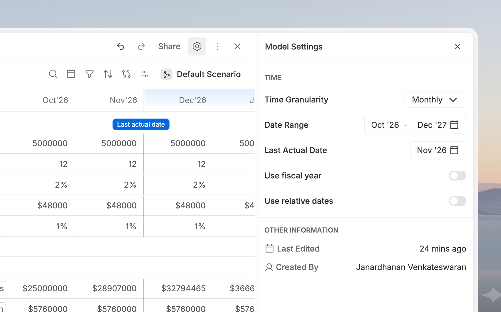

Each model lays its variables out across a sequence of periods. The model's time settings define those periods and decide which formula applies in each one. For example, a monthly model from `Jan '26` to `Dec '26` with a Last actual date of `Mar '26` shows three actual months and nine planned months.

<Frame caption="The TIME section of Model Settings">
  
</Frame>

## Model time settings

You find the time settings in the **TIME** section of **Model Settings**:

| Setting | What it controls |
| --- | --- |
| **Time Granularity** | Whether each period is a month, a quarter, or a year. See [Time granularity](/concepts/data-and-structure/time/time-granularity). |
| **Date Range** | The first and last period the model covers. |
| **Last Actual Date** | The last period that uses actual data. See [Last actual date](/concepts/data-and-structure/time/last-actual-date). |
| **Use fiscal year** | Whether quarters and years follow your fiscal year. When you turn it on, you choose the **Fiscal year end** month. |
| **Use relative dates** | Whether period columns show calendar labels such as `Jan'26` or relative labels such as `Month 1`. See [Relative time](/concepts/data-and-structure/time/relative-time). |

Workspace admins can set defaults for new models in the workspace **Planning** settings. These include **Default Planning Period**, **Default Forecast Frequency**, and **Fiscal Year Start**. The **Default Forecast Frequency** list labels yearly periods **Annual**.

## How time shapes calculation

The Last actual date splits every variable's timeline in two:

- Periods up to and including the Last actual date use the variable's **actual formula**.
- Periods after the Last actual date use the variable's **planned formula**.

The formula editor labels these tabs **Actual** and **Plan**. Actual formulas usually read from linked [Transactions](/concepts/data-and-structure/transactions). Planned formulas usually combine drivers and assumptions.

Formulas can also use [relative time](/concepts/data-and-structure/time/relative-time). A reference such as `previous month` moves with each period, so one formula works across the whole timeline.

## How time shapes reporting

When you review a model at a higher level, two separate ideas apply:

- **Time rollups** decide which periods group together. For example, three months group into one quarter.
- **Time aggregation** decides what value represents that group. For example, revenue shows the sum and headcount shows the final value.

You choose rollups in a view. You choose each variable's time aggregation in its formatting options. See [Time rollups and aggregation](/concepts/data-and-structure/time/time-aggregation).

## How the pieces work together

1. Set the granularity and date range.
2. Set the Last actual date to the last closed period.
3. Write actual and planned formulas for each variable.
4. Set the time aggregation for each variable that shouldn't sum.
5. Review quarter and year rollups to confirm the totals make sense.

## Related

- [Time granularity](/concepts/data-and-structure/time/time-granularity)
- [Last actual date](/concepts/data-and-structure/time/last-actual-date)
- [Relative time](/concepts/data-and-structure/time/relative-time)
- [Time rollups and aggregation](/concepts/data-and-structure/time/time-aggregation)
- [Model settings](/concepts/modeling/models/model-settings)
