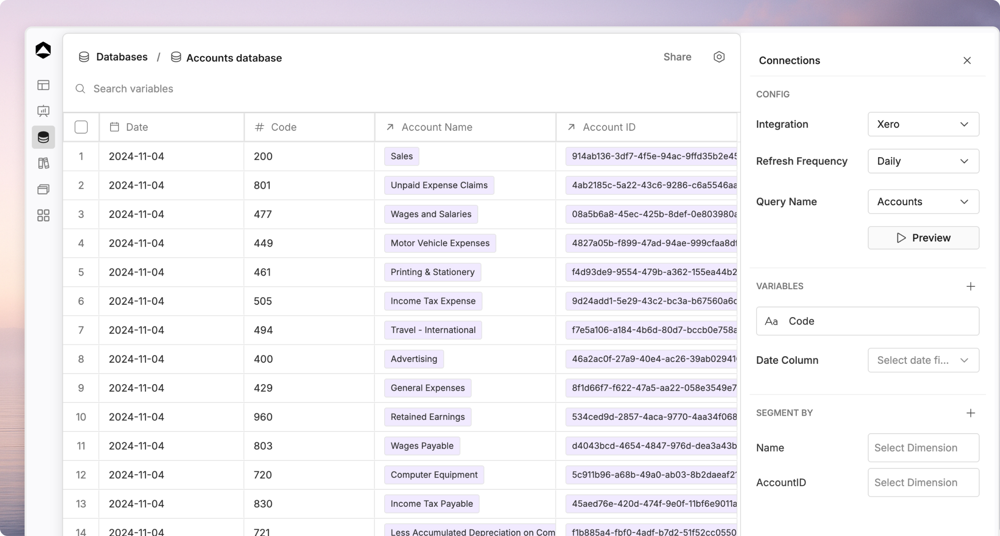

Transactions hold structured source records you can review directly or reuse across models, views, and boards. You manage them from the Library **Transactions** tab and create them with **Create Transactions**.

Older documentation called this surface **Databases**. In product UI and Concepts, the public name is **Transactions**.

<Frame caption="Transactions in Oculon">
  
</Frame>

## In this section

<Columns cols={2}>
  <Card title="What is a transaction" icon="circle-help" href="/concepts/data-and-structure/transactions/what-is-a-transaction">
    How Transactions fit as the source layer in Oculon.
  </Card>
  <Card title="Transaction types" icon="list" href="/concepts/data-and-structure/transactions/transaction-types">
    Choose manual ownership versus integration-backed sources.
  </Card>
  <Card title="Transaction structure" icon="table" href="/concepts/data-and-structure/transactions/transaction-structure">
    Design rows, columns, and grain for reuse.
  </Card>
  <Card title="Working with data" icon="table" href="/concepts/data-and-structure/transactions/working-with-data">
    Create, configure, edit, and maintain records.
  </Card>
  <Card title="Transaction formulas" icon="sigma" href="/concepts/data-and-structure/transactions/transaction-formulas">
    Keep calculated logic close to source records.
  </Card>
  <Card title="Filters, sorts, and grouping" icon="funnel" href="/concepts/data-and-structure/transactions/filters-sorts-and-grouping">
    Review the right slice of records without changing source data.
  </Card>
  <Card title="Linked data" icon="link" href="/concepts/data-and-structure/transactions/linked-data">
    Connect Transactions into models, dimensions, and boards.
  </Card>
  <Card title="Refresh and sync behavior" icon="refresh-cw" href="/concepts/data-and-structure/transactions/refresh-and-sync-behavior">
    Keep integration-backed sources current.
  </Card>
  <Card title="Transaction best practices" icon="badge-check" href="/concepts/data-and-structure/transactions/transaction-best-practices">
    Keep source data reliable and safe to reuse.
  </Card>
</Columns>
