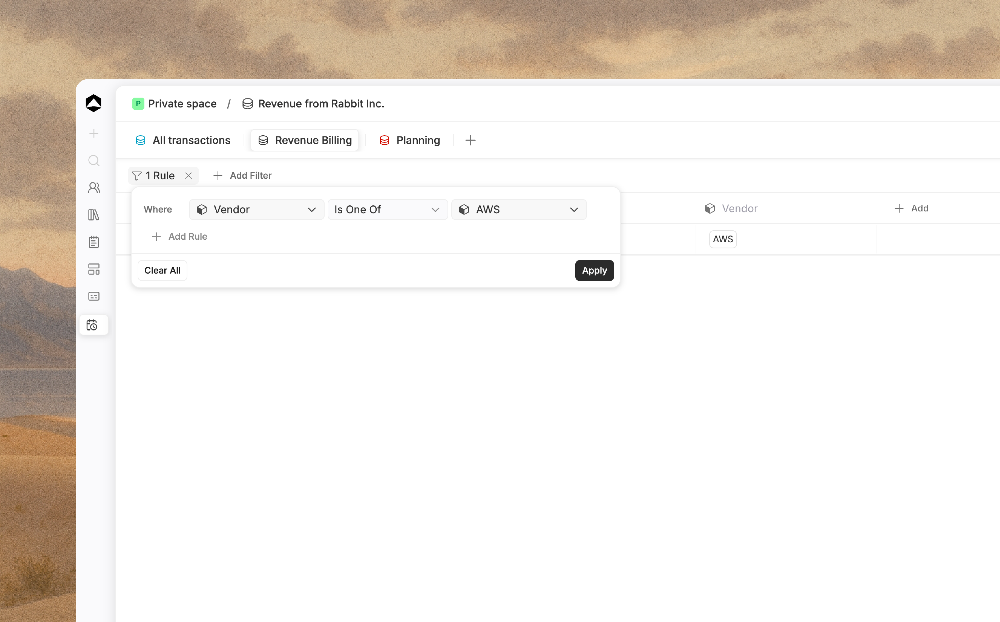

Filters, sorts, and grouping change how you see Transactions records. They don't change the records themselves. For example, you can filter `Customers` to `Region` = `EMEA`, sort by `MRR`, and group by `Plan`.

You can save that setup as a view. Each Transactions table keeps its own views, such as **Default View**, **Planning**, or **Revenue Billing**.

<Frame caption="Filtering a Transactions view">
  
</Frame>

## Filter

Click **Filter** to show only the records that match. For example, show only one region or one plan.

Use filters to check data quality before a model reads the records. For example, filter to the latest month to confirm that it arrived.

## Sort

Click **Sort** to order records by a column. For example, sort by `MRR` from largest to smallest to find your biggest customers.

## Group

Click **Group** to group records by a column, such as `Plan` or `Region`. Grouping helps you spot categories that are missing or used inconsistently.

## Save as a view

A view saves the filters, sorts, and groups you applied. Views appear as tabs above the grid. From a view's menu, you can **Copy link**, **Duplicate**, or **Delete** it.

Other people who open the Transactions see the same views. Your changes to the records show up in every view.

For how views work across models and Transactions, see [What is a view](/concepts/analysis-and-reporting/views/what-is-a-view).

## Keep views simple

If a view needs many rules before the data makes sense, the structure may need cleanup. See [Transaction structure](/concepts/data-and-structure/transactions/transaction-structure).

## Related

- [Working with data](/concepts/data-and-structure/transactions/working-with-data)
- [What is a view](/concepts/analysis-and-reporting/views/what-is-a-view)
- [Views: Filters, sorts, and grouping](/concepts/analysis-and-reporting/views/filters-sorts-and-grouping)
- [Transaction structure](/concepts/data-and-structure/transactions/transaction-structure)
