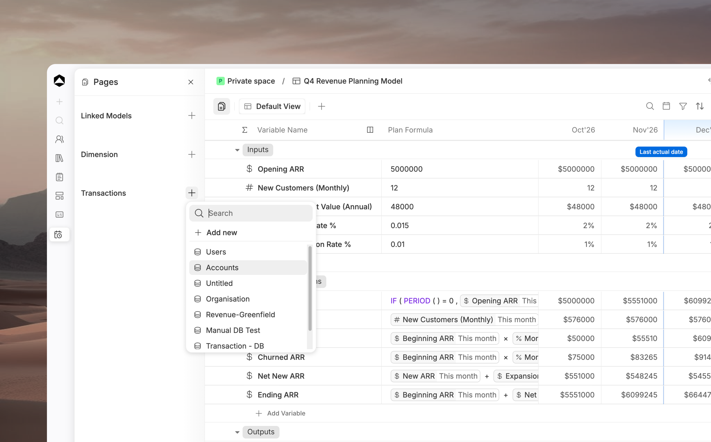

You link Transactions to a model so the model can use their records. After you link them, the model's formulas can reference the Transactions variables. Most often, you reference them in a variable's **actual formula**.

{/* TODO: screenshot of the model left panel with the Transactions section and a linked Transactions table open in the bottom panel */}

## Link Transactions to a model

1. Open the model.
2. In the left panel, find the **Transactions** section.
3. Click **+** (**Link transactions**) and choose the Transactions to link.

<Frame caption="Linking Transactions from a model's Pages panel">
  
</Frame>

Click a linked Transactions table in the panel to open it below the model. A model can link several Transactions tables. Each one must be in the same workspace as the model.

## How values reach the model

When a model reads a Transactions variable, three settings decide where each value lands:

- The **Date Column** places each record in a period at the model's granularity, such as `monthly`.
- The **Segment by** mappings split values by dimension, such as `Region`.
- The variable itself, such as `Amount`, provides the number.

For example, `Revenue` in a model can use `Amount` from `Invoices` as its actual formula. Each month up to the [Last actual date](/concepts/data-and-structure/time/last-actual-date) then shows the invoice total for that month. After that date, the **planned formula** takes over.

See [Transaction structure](/concepts/data-and-structure/transactions/transaction-structure) for how to set these columns.

## What else depends on Transactions

Once a model reads Transactions, the data also reaches what the model feeds:

- [Views](/concepts/analysis-and-reporting/views) and [Compare](/concepts/analysis-and-reporting/compare) on that model
- [Boards](/concepts/analysis-and-reporting/boards) built from the model
- Other models that link to that model

When Transactions refresh, all of these pick up the new values.

## Review dependencies before you change structure

Changes to Transactions can break the models that read them. Check linked models before you:

- remove or rename a variable
- change the Date Column
- change a Segment by mapping
- unlink the Transactions from a model

## Related

- [What is a transaction](/concepts/data-and-structure/transactions/what-is-a-transaction)
- [Transaction structure](/concepts/data-and-structure/transactions/transaction-structure)
- [Linked models](/concepts/modeling/models/linked-models)
- [Variable behavior](/concepts/data-and-structure/variables/variable-behavior)
- [Last actual date](/concepts/data-and-structure/time/last-actual-date)
