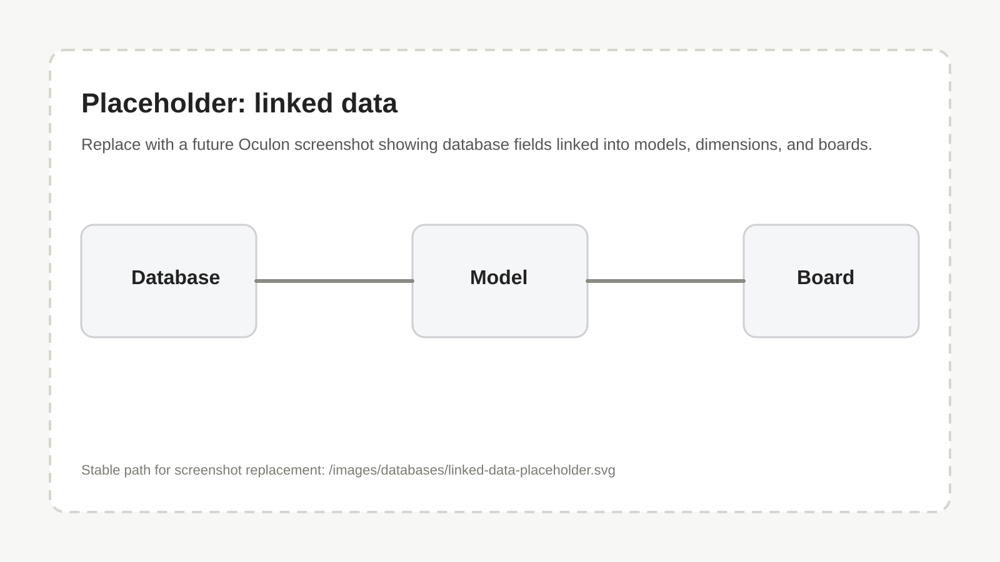

Linked data keeps Transactions records connected to the parts of Oculon that need them. That makes the data more reusable, but it also means source changes can have wider downstream effects.

<Frame caption="Transactions linked into models and boards">
  
</Frame>

## Where linked data shows up

Transactions data may later be used in:

- [models](/concepts/modeling/models/what-is-a-model) and model inputs
- [dimension](/concepts/data-and-structure/dimensions/what-is-a-dimension) mappings
- shared reporting views
- boards that depend on the same underlying records

This is why Transactions should not be treated as isolated infrastructure once they are in active use.

## Why linked data is valuable

Linked data reduces duplicate maintenance.

When the source updates cleanly:

- the same dataset can support several workflows
- teams do not need to rebuild the same records repeatedly
- source-level cleanup improves several downstream outputs at once

## What breaks when the source changes

Linked workflows become fragile when the source structure changes without review.

Common risks include:

- renamed fields
- changed category values
- inconsistent date behavior
- missing records after a refresh
- structural changes that no longer match downstream mappings

## Review dependencies after change

If Transactions change, review the linked workflows before you assume everything still behaves correctly.

Start with:

- the mapped fields
- any dependent dimensions
- downstream models
- key boards or tables used by other teams

## Keep ownership visible

Linked data works best when the source has a clear owner and the downstream consumers understand what they are inheriting.

That reduces the chance that one team quietly changes a source structure that several other teams depend on.

## Related pages

- [What is a transaction](/concepts/data-and-structure/transactions/what-is-a-transaction)
- [Transaction structure](/concepts/data-and-structure/transactions/transaction-structure)
- [Working with data](/concepts/data-and-structure/transactions/working-with-data)
- [Linked models](/concepts/modeling/models/linked-models)
