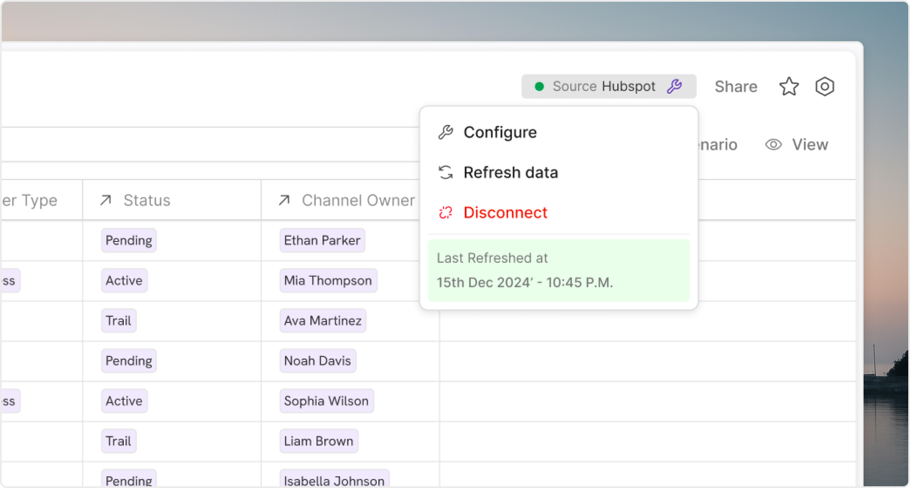

Refresh behavior determines when Oculon pulls the latest data from a source and how quickly dependent workflows should reflect that change. For integration-backed Transactions, this is part of the operating rhythm, not just a technical detail.

<Frame caption="Connection and refresh status">
  
</Frame>

## What a refresh should do

A refresh should update the Transactions records first. After that, dependent models, views, and boards should reflect the new state according to their own calculation and display behavior.

That is why source-first validation is so important. If the source dataset itself is not current, downstream review will usually waste time.

## Manual and scheduled refreshes

Both refresh patterns are useful:

- **Scheduled refreshes** help keep operational data current without manual effort.
- **Manual refreshes** help when you need to validate a source change immediately or confirm a fix before the next normal cycle.

The right choice depends on how often the source changes and how sensitive the downstream workflows are to stale data.

## Check the source before the output

If a board or model looks wrong after a sync, start with the Transactions record set and the connection status.

Review:

- whether the refresh actually completed
- whether the expected records arrived
- whether the source query changed
- whether a mapping broke after the refresh

## Keep refresh ownership clear

Teams move faster when everyone knows:

- who owns the source connection
- who checks refresh failures
- which Transactions require scheduled monitoring
- which downstream workflows are most sensitive to stale data

## Common failure modes

The most common sync problems come from:

- source schema changes
- delayed refresh timing
- missing records after a query change
- teams checking the modeled output before checking the source

## Related pages

- [Working with data](/concepts/data-and-structure/transactions/working-with-data)
- [Linked data](/concepts/data-and-structure/transactions/linked-data)
- [Data mismatches](/concepts/resources/troubleshooting)
- [Transaction best practices](/concepts/data-and-structure/transactions/transaction-best-practices)
