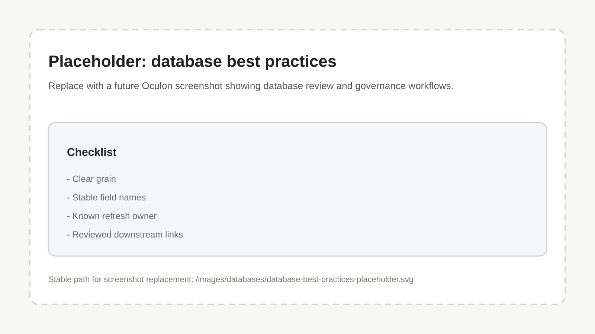

Good Transactions support planning without becoming another source of confusion. The best ones stay simple enough to trust and structured enough to reuse across several downstream workflows.

<Frame caption="Review and governance habits">
  
</Frame>

## Start with the smallest useful structure

Do not add more fields, categories, or granularity than the workflow actually needs.

The smallest useful structure is often easier to maintain, easier to review, and easier to map into models later.

## Keep raw and modeled logic separate

Use Transactions to store records, source values, and row-level logic that belongs to the data itself.

Use the [model](/concepts/modeling/models/what-is-a-model) for:

- planning assumptions
- scenario logic
- business rules that span several records
- outputs designed for decision-making

That split makes both layers easier to change safely.

## Use stable names and clear field meaning

A dataset becomes harder to trust when field names drift or a single column starts carrying several meanings.

Prefer:

- business-readable field names
- one clear meaning per column
- clean date and category fields when they matter downstream
- controlled structural changes instead of ad hoc edits

## Govern change like shared infrastructure

If several models or boards depend on the same Transactions, manage changes carefully.

Review schema changes before you:

- rename important fields
- remove columns
- change category meanings
- alter the effective grain of the dataset

## Make sync ownership explicit

Every important dataset should have a clear owner for:

- refresh timing
- source query review
- connection issues
- downstream change communication

That ownership matters just as much as the technical setup.

## Retire stale Transactions deliberately

Unused or outdated datasets create risk when teams assume they are still current.

Archive or retire stale datasets deliberately so people do not build new work on top of old records.

## Before you rely on Transactions broadly

Use this checklist before you publish or reuse a dataset widely:

- confirm the structure matches the intended workflow
- confirm the grain is clear
- confirm key fields are typed and named clearly
- confirm refresh ownership is clear
- confirm linked models, boards, or mappings still behave as expected

## Related pages

- [Transaction structure](/concepts/data-and-structure/transactions/transaction-structure)
- [Refresh and sync behavior](/concepts/data-and-structure/transactions/refresh-and-sync-behavior)
- [Data mismatches](/concepts/resources/troubleshooting)
- [Model best practices](/concepts/modeling/models/model-best-practices)
