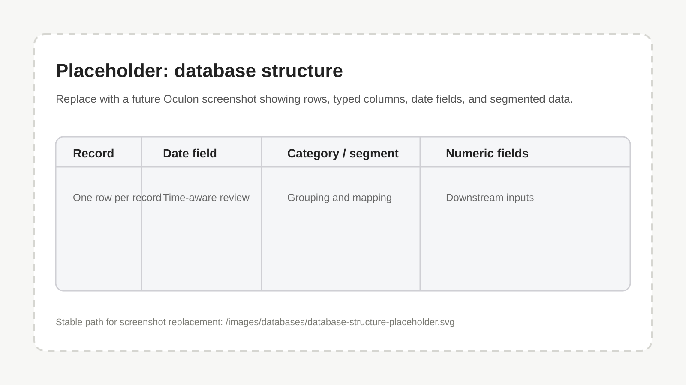

Structure determines how easy records are to review, map, and reuse later. A clean structure reduces downstream cleanup. A weak structure creates friction in every model or board that depends on it.

<Frame caption="Rows, columns, and typed fields">
  
</Frame>

## Start with the downstream use case

Before you add fields, decide how the dataset will be used.

Common questions include:

- Will the records feed a model?
- Will users filter or group the data directly?
- Does the dataset need a date field for time-based review?
- Should one or more fields later map to dimensions or categories?

Those answers usually matter more than the raw source shape.

## Rows and columns

In most Transactions datasets:

- each row represents one record
- each column represents one field on that record

That sounds simple, but the record grain matters. A dataset becomes much harder to trust when one row mixes several business events or several time periods together.

## Choose the right granularity

Granularity is the level of detail each row represents.

A useful dataset usually keeps one clear grain, such as:

- one transaction per row
- one customer per row
- one employee per row
- one opportunity snapshot per row

If the grain is unclear, filters, formulas, and model mappings become harder to validate.

## Add date and category fields deliberately

Date and category fields often carry more downstream value than teams expect.

They help with:

- time-based review
- sorting and filtering
- grouping records into useful slices
- mapping fields into models and dimensions

If you need time-aware analysis later, include a clean date field now instead of rebuilding the structure later.

## Keep column types readable

A well-typed, well-named field is easier to review than a catch-all text field with mixed content.

Prefer:

- one meaning per column
- stable, business-readable names
- separate numeric, text, date, and category fields where possible

## Treat structural changes carefully

Once Transactions feed models, views, or boards, structural changes can have a wide effect.

Be especially careful with:

- renaming columns
- removing fields
- changing the meaning of a category
- changing the effective grain of the records

## Related pages

- [Working with data](/concepts/data-and-structure/transactions/working-with-data)
- [Linked data](/concepts/data-and-structure/transactions/linked-data)
- [Using dimensions with variables](/concepts/data-and-structure/dimensions/using-dimensions-with-variables)
- [Transaction best practices](/concepts/data-and-structure/transactions/transaction-best-practices)
