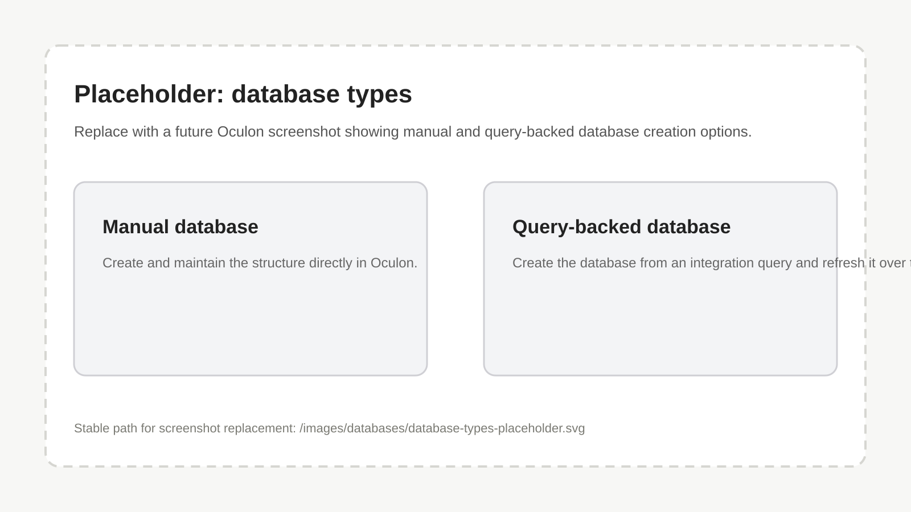

Transactions can start from different ownership models. The most common choice is between a dataset you manage directly in Oculon and one created from an integration workflow.

<Frame caption="Manual and integration-backed Transactions">
  
</Frame>

## Manual Transactions

Use manual Transactions when your team wants to define and maintain the structure directly in Oculon.

Create them from the Library with **Create Transactions**.

This works well for:

- planning support tables
- controlled reference lists
- operational records that do not need an external source system
- shared tables that a team updates directly in the app

## Integration-backed Transactions

Use integration-backed Transactions when the data should come from an external source through an integration.

From an integration, you can **Create Transactions** so the source can refresh over time.

This works well when:

- another system owns the records
- refresh timing matters
- the same source should feed several downstream workflows
- you want a repeatable import path instead of manual updates

## How to choose

Choose based on ownership first.

- If Oculon is where the team maintains the records, use manual Transactions.
- If another system owns the records, use integration-backed Transactions.

That choice usually matters more than convenience because it affects refresh behavior, change control, and who is responsible for data quality.

## Mixed workflows are common

Many teams use both patterns in the same workspace.

For example:

- integration-backed Transactions for CRM opportunity data
- manual Transactions for planning assumptions or mapping tables

That is often a healthy setup as long as each dataset has a clear owner.

## What to review before you create one

Before you choose a type, confirm:

- where the source of truth should live
- how often the records change
- who is allowed to edit the records
- whether the dataset will later feed models or dimensions

## Related pages

- [What is a transaction](/concepts/data-and-structure/transactions/what-is-a-transaction)
- [Working with data](/concepts/data-and-structure/transactions/working-with-data)
- [Refresh and sync behavior](/concepts/data-and-structure/transactions/refresh-and-sync-behavior)
- [Transaction best practices](/concepts/data-and-structure/transactions/transaction-best-practices)
