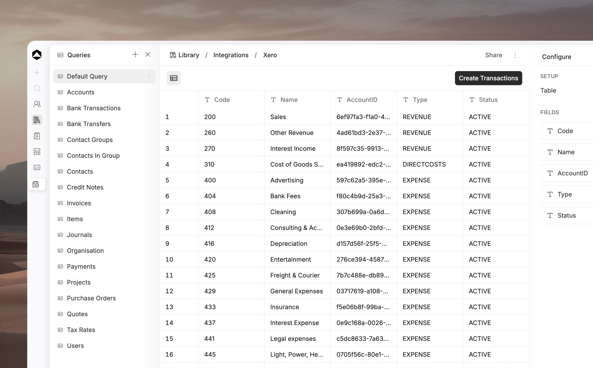
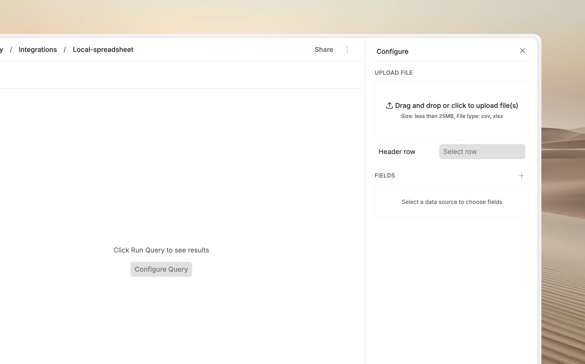
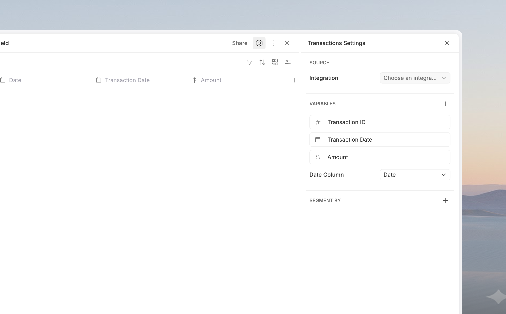

Every Transactions table gets its records from a source. You can connect an integration, upload a file, or enter rows yourself. Choose the source based on which system owns the records.

{/* TODO: screenshot of the Transactions Settings Source section with the Integration and Query fields */}

## Integration

An integration connects Oculon to an external system. Examples include Xero, QuickBooks, HubSpot, and Google Sheets. The connectors available to you depend on your workspace.

<Frame caption="A Xero integration with its queries">
  
</Frame>

Records reach Transactions in three steps:

1. **Connection.** You set up the integration in the Library **Integrations** tab.
2. **Query.** A query on that integration selects which records to pull, such as invoices or customers.
3. **Transactions.** In **Transactions Settings**, you choose the integration in **Integration** and the query in **Query**. You then set a **Refresh Frequency**.

Click **Preview** to check the query results before you save.

Use an integration when another system owns the records and they change often.

## File upload

You can upload a CSV or Excel file. In the **Upload Excel File** dialog, click **Choose CSV or XLSX file** or drag the file in. If the workbook has several sheets, you pick the sheet to use.

<Frame caption="Uploading a file to a Local-spreadsheet integration">
  
</Frame>

Use a file upload for one-off imports, such as a historical export from a system you don't connect directly.

## Manual entry

You can create Transactions without a source and enter the records yourself. Click **Create Transactions** in the Library. You then add a date column, variables, and dimension columns, and insert rows.

<Frame caption="Setting up Transactions for manual entry">
  
</Frame>

Use manual entry for small tables your team maintains in Oculon, such as a list of one-off adjustments.

See [Working with data](/concepts/data-and-structure/transactions/working-with-data) for how to add rows and edit values.

## How to choose

| Source | Use it when |
| :--- | :--- |
| Integration | Another system owns the records, and you want them to stay current. |
| File upload | You have a one-off export or a system you don't connect directly. |
| Manual entry | Your team owns the records and maintains them in Oculon. |

Many workspaces use more than one source. For example, invoices might come from Xero while a small adjustments table is maintained by hand.

## Related

- [What is a transaction](/concepts/data-and-structure/transactions/what-is-a-transaction)
- [Working with data](/concepts/data-and-structure/transactions/working-with-data)
- [How data flows through Oculon](/concepts/core-concepts/how-data-flows-through-oculon)
