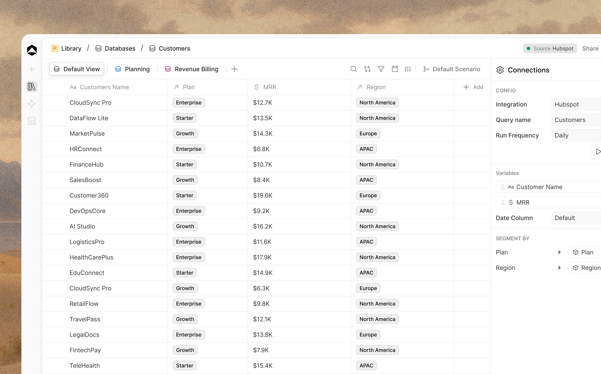

Transactions (formerly Databases) are tables of source records in Oculon. Each row is one record, such as an invoice, a ledger entry, or a customer subscription. For example, a `Customers` table might list each customer with their `Plan`, `Region`, and `MRR`.

Transactions store records in their original detail. They don't hold plan values. Models link to Transactions and read from them in actual formulas.

<Frame caption="A Transactions table">
  
</Frame>

## How records get in

You bring records into Transactions in one of three ways:

- **Integration.** You choose an integration and a query. Oculon loads the query results and refreshes them on a schedule.
- **File upload.** You upload a CSV or Excel file.
- **Manual entry.** You add rows and enter values yourself.

See [Transaction sources](/concepts/data-and-structure/transactions/transaction-types) to choose between them.

## How Transactions are structured

The settings for a Transactions table decide how its columns behave:

- The **Date Column** places each record in a time period.
- **Variables** are the value fields, such as `MRR` or `Amount`. Each has a type: Number, Currency, Date, Percentage, or Boolean.
- **Segment by** fields map to [dimensions](/concepts/data-and-structure/dimensions), such as `Region` or `Plan`.

See [Transaction structure](/concepts/data-and-structure/transactions/transaction-structure) for details.

## How models use Transactions

You link Transactions to a [model](/concepts/modeling/models) from the model's **Transactions** panel. The model's formulas can then reference the Transactions variables.

You usually reference them in a variable's **actual formula**. For example, `Revenue` can read `MRR` from `Customers` for each month up to the [Last actual date](/concepts/data-and-structure/time/last-actual-date). After that date, the **planned formula** takes over.

Because Segment by fields map to shared dimensions, the model can break the values down by the same categories. See [Linked data](/concepts/data-and-structure/transactions/linked-data).

## Where Transactions live

Transactions live in a space, like models and boards. The Library **Transactions** tab lists every Transactions table you can access. If you create Transactions from the Library, Oculon saves them to your Private Space.

Each Transactions table can have its own saved views. See [Filters, sorts, and grouping](/concepts/data-and-structure/transactions/filters-sorts-and-grouping).

## Transactions versus models

| Use Transactions for | Use a model for |
| :--- | :--- |
| Row-level records from a source system | Calculations, drivers, and assumptions |
| Actuals at their original detail | Planned values after the Last actual date |
| Reviewing and cleaning source data | Scenarios and what-if analysis |

## Related

- [Transaction sources](/concepts/data-and-structure/transactions/transaction-types)
- [Transaction structure](/concepts/data-and-structure/transactions/transaction-structure)
- [Linked data](/concepts/data-and-structure/transactions/linked-data)
- [How data flows through Oculon](/concepts/core-concepts/how-data-flows-through-oculon)
- [What is a model](/concepts/modeling/models/what-is-a-model)
