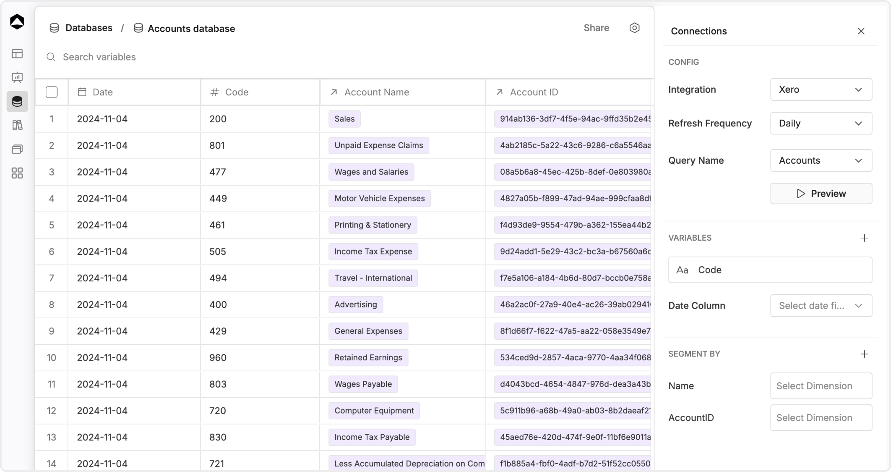

Working with data in Oculon is usually a cycle of creating Transactions, confirming the structure, reviewing the incoming records, and keeping the dataset usable as the source changes.

<Frame caption="Transactions configuration">
  
</Frame>

## A practical workflow

Most work follows this pattern:

1. Create Transactions manually or from an integration.
2. Confirm the incoming fields and record shape.
3. Review data quality before you connect the dataset to a model.
4. Adjust columns, mappings, and structure where needed.
5. Refresh and recheck the data as the source changes.

## Create and configure

If the data is managed in Oculon, use Library **Create Transactions** and define the columns directly.

If the data comes from an external source, set up the integration first, then **Create Transactions** from that integration workflow.

After the dataset exists, open it from the Library **Transactions** tab and review configuration carefully. This is usually where you confirm source settings, field selection, and how the structure should behave downstream.

Use **Transactions Settings** and **Share Transactions** when you need settings or sharing controls on an open dataset.

## Add and edit rows and columns intentionally

When you add or change data directly, think beyond the current table view.

Review:

- whether the new field has one clear meaning
- whether the column name will still make sense in a model or board
- whether a row-level edit changes an important downstream mapping
- whether the dataset still has one consistent grain

For filter, sort, and grouping controls while you review records, see [Filters, sorts, and grouping](/concepts/data-and-structure/transactions/filters-sorts-and-grouping).

For row-level calculated fields, see [Transaction formulas](/concepts/data-and-structure/transactions/transaction-formulas).

## Rename with care

Renaming Transactions or one of their fields can improve clarity, but it can also create confusion if other teams already rely on the current name.

Rename when the improvement is meaningful, not just cosmetic.

## Export and review

Exports are useful when you need an offline review, a handoff, or a quick comparison against another source.

Before you export:

- confirm the active filters and grouping
- confirm the dataset is current
- confirm the audience needs raw records rather than modeled output

## Delete only when you are sure it is unused

Deleting Transactions is a bigger decision than hiding them from a workflow.

Review dependent models, boards, or team processes first. A stale dataset should usually be retired deliberately, not removed casually.

## Keep raw and modeled logic separate

Use Transactions to store and organize the records.

Use the [model](/concepts/modeling/models/what-is-a-model) to decide what those records mean for planning, forecasting, and reporting. That split makes changes easier to review later.

## Related pages

- [Transaction structure](/concepts/data-and-structure/transactions/transaction-structure)
- [Filters, sorts, and grouping](/concepts/data-and-structure/transactions/filters-sorts-and-grouping)
- [Refresh and sync behavior](/concepts/data-and-structure/transactions/refresh-and-sync-behavior)
- [Data mismatches](/concepts/resources/troubleshooting)
