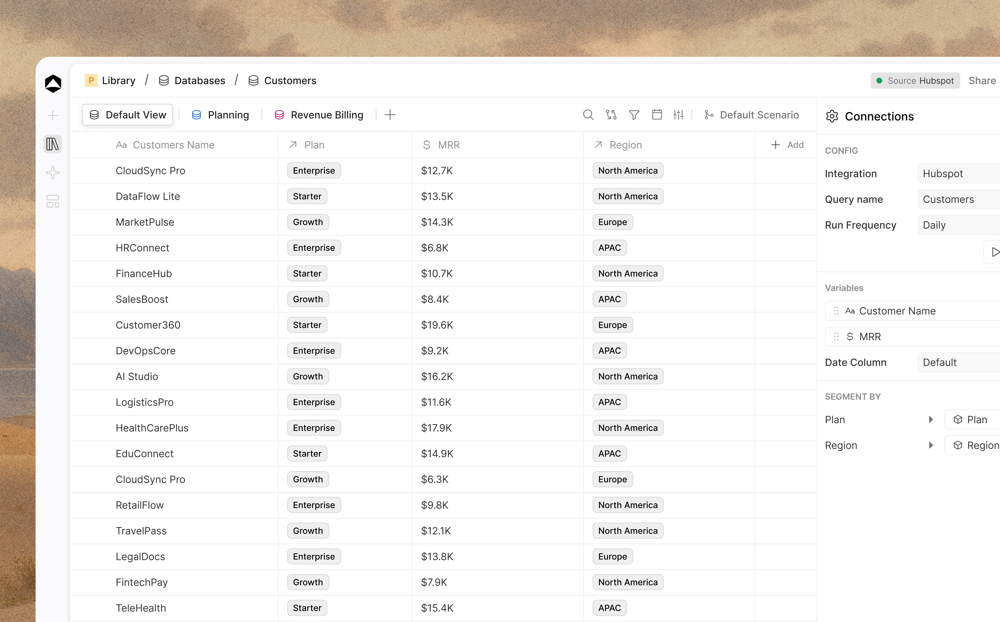
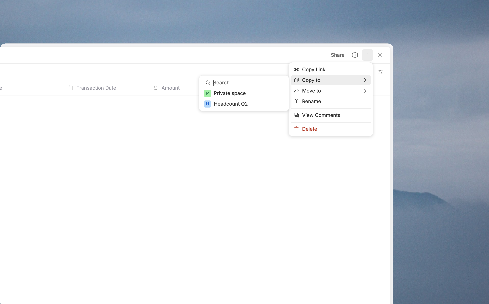

Working with Transactions follows a short cycle. You set up the source and columns, check the records, and then edit or add rows as needed. This page covers each step.

<Frame caption="A Transactions table with its settings open">
  
</Frame>

## Create Transactions

Click **Create Transactions** in the Library. Oculon saves the new Transactions to your Private Space. Move them to a teamspace when others need them.

## Configure the settings

Open **Transactions Settings** from the Transactions header. The settings have these parts:

- **Source.** Choose an **Integration**, a **Query**, and a **Refresh Frequency**. Click **Preview** to see the query results. Skip this section for manual Transactions.
- **Variables.** Add the value fields a model should be able to read, and set each one's type.
- **Date Column.** Choose the field that dates each record.
- **Segment by.** Map fields to workspace dimensions.

Click **Save** to apply the settings. Oculon then loads the records into the grid.

See [Transaction structure](/concepts/data-and-structure/transactions/transaction-structure) for what each column role does.

## Add rows

To add a row, select an existing row and choose **Insert row below**. Then fill in the date and the other cells.

## Edit values

You can type over a cell value in the grid. Oculon saves your edit as an override on that cell. To remove the override, clear the cell.

If you type a value that starts with `=`, Oculon saves it as a formula. See [Transaction formulas](/concepts/data-and-structure/transactions/transaction-formulas).

## Add columns

Click **Add** at the end of the column headers. Choose **Variable** to add a value column, or **Dimension** to add a column mapped to a workspace dimension.

## Rename, share, and delete

From the row menu in the Library, you can **Rename**, **Share**, or **Delete** Transactions. Inside the Transactions, click **Share** in the header to give people access.

The **⋮** menu in the header also lets you **Copy Link**, **Copy to** or **Move to** another space, **Rename**, **View Comments**, or **Delete**.

<Frame caption="The Transactions header menu">
  
</Frame>

Before you rename or delete Transactions, check which models link to them.

## Related

- [Transaction sources](/concepts/data-and-structure/transactions/transaction-types)
- [Transaction structure](/concepts/data-and-structure/transactions/transaction-structure)
- [Filters, sorts, and grouping](/concepts/data-and-structure/transactions/filters-sorts-and-grouping)
