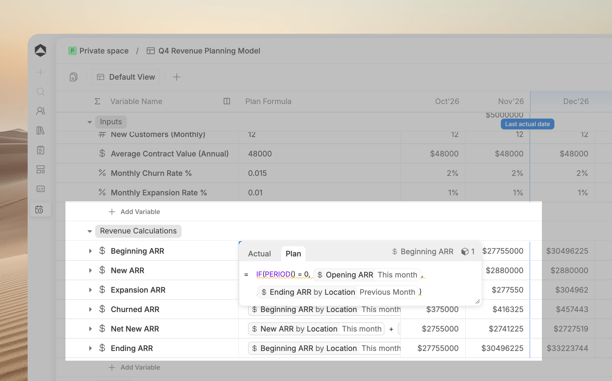

A variable is one line in a model, such as `New ARR`, `Monthly Churn Rate %`, or `Headcount`. It holds input values, a formula, or both, with a value for every period in the model.

<Frame caption="Variables in a revenue planning model">
  
</Frame>

## In this section

<Columns cols={2}>
  <Card title="What is a variable" icon="circle-question-mark" href="/concepts/data-and-structure/variables/what-is-a-variable">
    The parts of a variable and how they fit together.
  </Card>
  <Card title="Variable types" icon="list" href="/concepts/data-and-structure/variables/variable-types">
    Number, Currency, Date, Percentage, and Boolean.
  </Card>
  <Card title="Create and edit variables" icon="pencil" href="/concepts/data-and-structure/variables/create-and-edit-variables">
    Add, rename, and reorder variables in a model.
  </Card>
  <Card title="Variable breakdown" icon="layout-grid" href="/concepts/data-and-structure/variables/variable-breakdown">
    Break a variable down by one or more dimensions.
  </Card>
  <Card title="Variable formatting" icon="ruler" href="/concepts/data-and-structure/variables/variable-formatting">
    Control how values display and aggregate.
  </Card>
  <Card title="Variable behavior" icon="activity" href="/concepts/data-and-structure/variables/variable-behavior">
    How a variable calculates across the Last actual date, overrides, and dimensions.
  </Card>
  <Card title="Variable references" icon="link" href="/concepts/data-and-structure/variables/variable-references">
    Reference variables in formulas, including from linked models.
  </Card>
  <Card title="Currency variables" icon="coins" href="/concepts/data-and-structure/variables/currency-and-conversion">
    Choose the currency a monetary variable displays.
  </Card>
  <Card title="Variable best practices" icon="badge-check" href="/concepts/data-and-structure/variables/variable-best-practices">
    Naming, structure, and shared-logic habits.
  </Card>
</Columns>

## Related

- [Core concepts overview](/concepts/core-concepts/core-concepts-overview)
- [Dimensions](/concepts/data-and-structure/dimensions)
- [Formulas](/concepts/modeling/formulas)
- [Models](/concepts/modeling/models)
