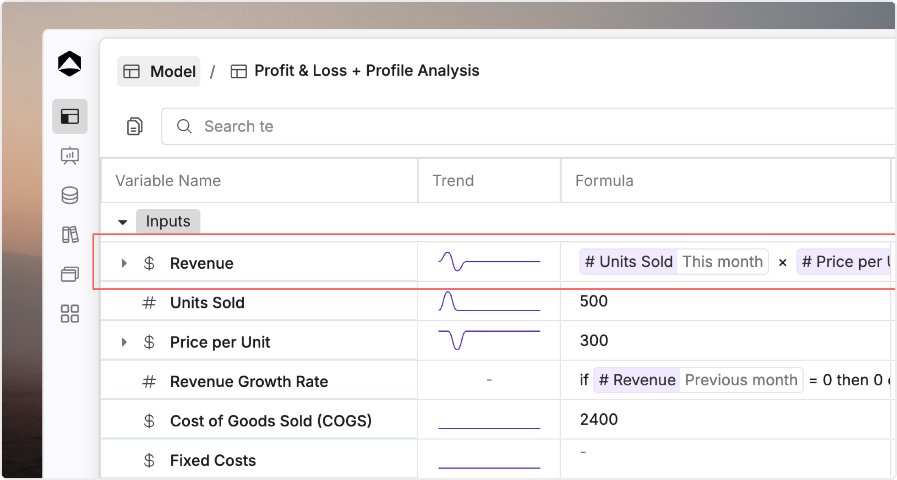

Variables are the building blocks of every model in Oculon. Each variable represents a metric, driver, assumption, or calculated line that you track over time, often broken down by [dimensions](/concepts/data-and-structure/dimensions/what-is-a-dimension).

<Frame caption="A variable in a model">
  
</Frame>

## In this section

<Columns cols={2}>
  <Card title="What is a variable" icon="circle-help" href="/concepts/data-and-structure/variables/what-is-a-variable">
    Core definition and the parts of a variable.
  </Card>
  <Card title="Variable types" icon="list" href="/concepts/data-and-structure/variables/variable-types">
    Number, currency, percent, date, and boolean.
  </Card>
  <Card title="Create and edit variables" icon="pencil" href="/concepts/data-and-structure/variables/create-and-edit-variables">
    Add, rename, reorder, and organize variables in a model.
  </Card>
  <Card title="Variable breakdown" icon="layout-grid" href="/concepts/data-and-structure/variables/variable-breakdown">
    Attach dimensions to slice a metric by category.
  </Card>
  <Card title="Variable formatting" icon="ruler" href="/concepts/data-and-structure/variables/variable-formatting">
    Control how values display in the model.
  </Card>
  <Card title="Variable behavior" icon="activity" href="/concepts/data-and-structure/variables/variable-behavior">
    How variables behave across time, dimensions, and the Last actual date.
  </Card>
  <Card title="Variable references" icon="link" href="/concepts/data-and-structure/variables/variable-references">
    Reference variables in formulas and linked models.
  </Card>
  <Card title="Currency and conversion" icon="coins" href="/concepts/data-and-structure/variables/currency-and-conversion">
    Choose currency display for monetary variables.
  </Card>
  <Card title="Variable best practices" icon="badge-check" href="/concepts/data-and-structure/variables/variable-best-practices">
    Naming, structure, and shared-logic habits.
  </Card>
</Columns>
