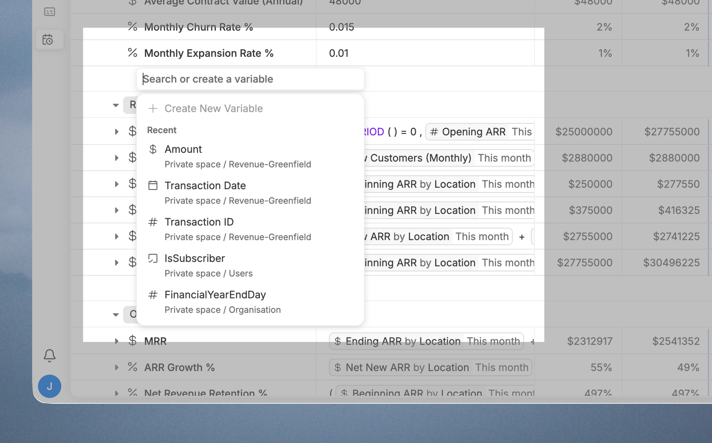
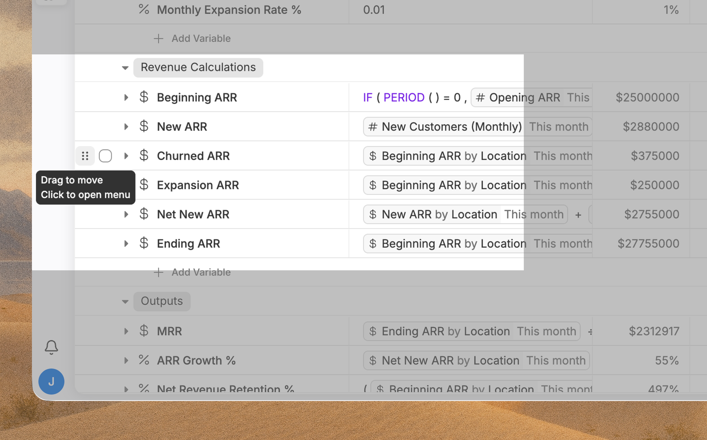

You create variables inside the model section where they belong. Most teams add a first draft quickly, then refine names, types, and order as the model settles.

## Create a variable

<Frame caption="Creating or adding a variable">
  
</Frame>

1. Click **+ Add Variable** at the bottom of a section.
2. Type a name in **Search or create a variable**.
3. Select **Create** followed by your name to add a new variable.

The new variable starts empty. You can then enter values or write a formula.

The same search also finds existing variables in other models, Transactions, and dimensions. Before you type, the list shows **Recent** variables and where each one lives, such as `Private space / Revenue-Greenfield`. Select one to bring it into this model instead of rebuilding it. See [Variable references](/concepts/data-and-structure/variables/variable-references).

## Edit a variable

You can change a variable's name, type, formatting, formulas, and breakdown after you create it.

- To change the type or formatting, click the type icon next to the variable name. See [Variable types](/concepts/data-and-structure/variables/variable-types) and [Variable formatting](/concepts/data-and-structure/variables/variable-formatting).
- To change the breakdown, use the dimension control next to the variable name. See [Variable breakdown](/concepts/data-and-structure/variables/variable-breakdown).
- To change the calculation, edit the actual formula or planned formula. See [Formula editor](/concepts/modeling/formulas/formula-editor).

Before you change a variable that other formulas or boards use, check what depends on it.

## Reorder variables

<Frame caption="The drag handle on a variable row">
  
</Frame>

Hover a variable row to show its drag handle. Drag the handle to move the variable to another position in the same section or to a different section. Click the handle to open the row menu.

## Organize as you go

Group variables into sections by role. For example, keep inputs, drivers, calculations, and outputs in separate sections. A consistent order makes the model easier to scan and review.

Prefer stable business names over temporary labels. Collaborators search for variables by name, so frequent renames make them harder to find.

## Related

- [What is a variable](/concepts/data-and-structure/variables/what-is-a-variable)
- [Model structure](/concepts/modeling/models/model-structure)
- [Variable best practices](/concepts/data-and-structure/variables/variable-best-practices)
