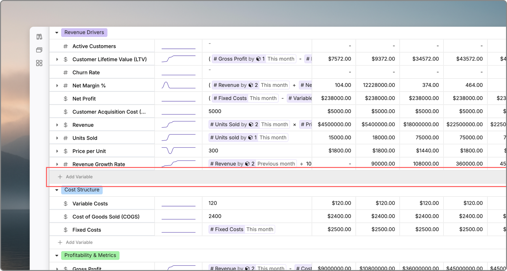
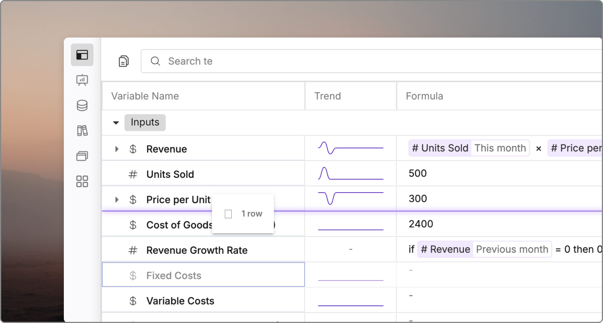

You create variables directly in the model where the planning logic lives. Most teams create a first draft quickly, then refine naming, formatting, and grouping as the model becomes more stable.

## Create a variable

<Frame caption="Create a variable in a model">
  
</Frame>

Use **Add variable** at the bottom of a section to create an empty variable. Once created, you can name it immediately and start entering values or a formula.

## Edit a variable

You can update the name, format, formula, dimensions, and position of an existing variable. If the variable is already used in formulas or boards, review dependent content before you make a structural change.

## Move a variable

<Frame caption="Reorder variables">
  
</Frame>

You can reorder variables to keep your model logical and easy to navigate. Simply click and drag any variable to move it to a new position within the same section or to a different section entirely.

## Organize variables as you go

Use sections and a consistent ordering pattern. Keep inputs, drivers, calculations, and outputs separate so the model is easy to scan.

## Rename carefully

If a variable is widely referenced, renaming it may affect how collaborators search for it or how formulas are understood. Prefer stable business names over temporary labels.
