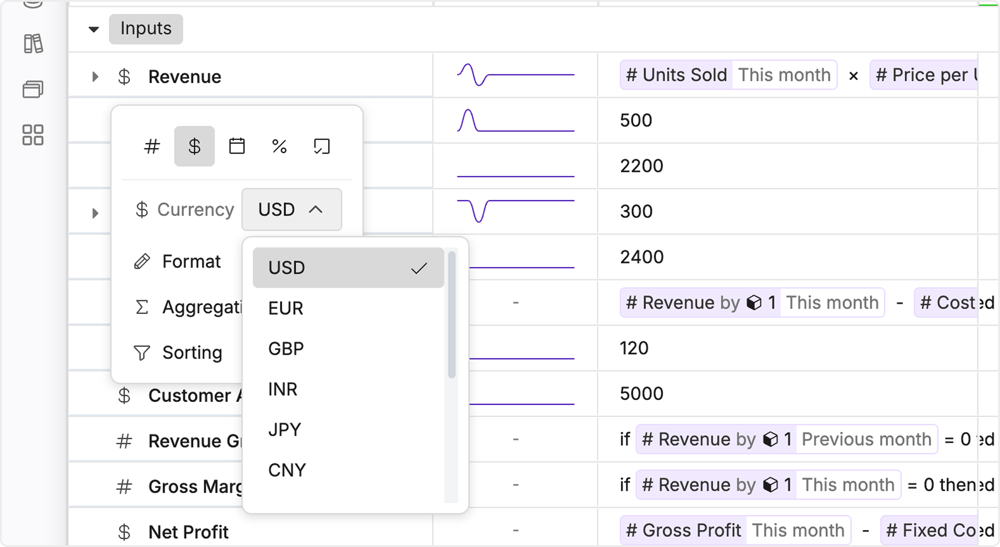

When a variable uses the **Currency** type, you can choose which currency symbol Oculon displays for its values. This keeps financial lines readable when collaborators review models, views, and boards.

<Frame caption="Currency display">
  
</Frame>

## Why it matters

Using a clear currency display helps when you work with multi-currency models or executive reports.

- Keeps values consistent across models and dashboards
- Helps distinguish currencies such as USD, INR, and EUR
- Improves readability in time-based tables and reports

## How to change currency

Update the currency from the variable format settings:

1. Select the variable in the model.
2. Open **Format**.
3. Choose the **Currency** control.
4. Select the desired currency (for example USD, INR, or EUR).

You can also start from a Currency [variable type](/concepts/data-and-structure/variables/variable-types), then refine display options under [Variable formatting](/concepts/data-and-structure/variables/variable-formatting).

## What changes

- The currency symbol updates across the variable's time cells.
- The display applies consistently in models, views, and boards.
- Changing the display currency does **not** convert the underlying numeric values. It changes how those values are shown.

## Example

If you change the display currency from USD to INR, a value shown as `$1,000` can appear as `₹1,000` across the model. The stored number stays the same unless you change the data or formula.

## Workspace Planning defaults

Workspace admins can also configure planning-related defaults (including currency-related preferences) in admin **Planning** settings. Variable-level format choices still control how each currency variable displays in a model.

<Note>
Display currency on a variable is separate from any future FX conversion workflows. This page covers display selection only.
</Note>

## Related

- [Variable types](/concepts/data-and-structure/variables/variable-types)
- [Variable formatting](/concepts/data-and-structure/variables/variable-formatting)
