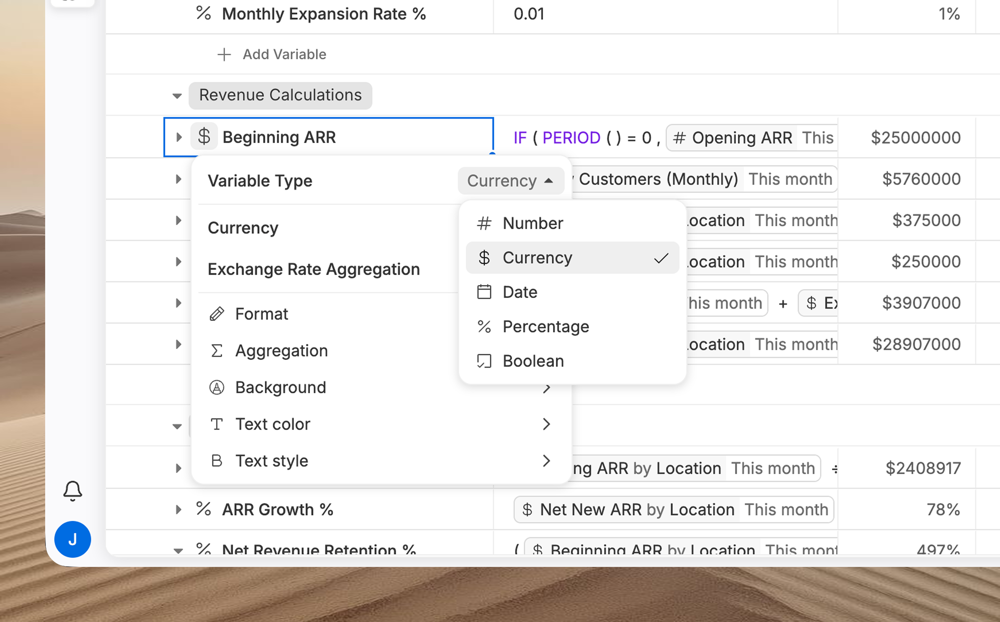

A Currency variable shows its values with a currency symbol. You choose the currency for each variable. For example, `Revenue` can display in USD while `Payroll India` displays in INR.

<Frame caption="Choosing the Currency type for a variable">
  
</Frame>

## Set the currency

1. Click the type icon next to the variable name.
2. In **Variable Type**, choose **Currency**.
3. In **Currency**, choose a currency.

New Currency variables use USD until you choose another currency.

## Available currencies

You can choose USD, EUR, GBP, INR, JPY, CNY, AUD, CAD, CHF, SEK, NOK, or DKK.

## What changes

- The currency symbol updates on the variable's values, such as `$` for USD or `₹` for INR.
- The stored values don't change.

<Note>
Changing the currency changes the symbol, not the amount. If you switch a variable from USD to INR, `$1,000` displays as `₹1,000`. Oculon doesn't convert the value at an exchange rate.
</Note>

Currency variables also show an **Exchange Rate Aggregation** setting with **Default**, **Average**, and **Closing** options. Choosing an option doesn't convert the variable's values.

## Related

- [Variable types](/concepts/data-and-structure/variables/variable-types)
- [Variable formatting](/concepts/data-and-structure/variables/variable-formatting)
- [What is a variable](/concepts/data-and-structure/variables/what-is-a-variable)
