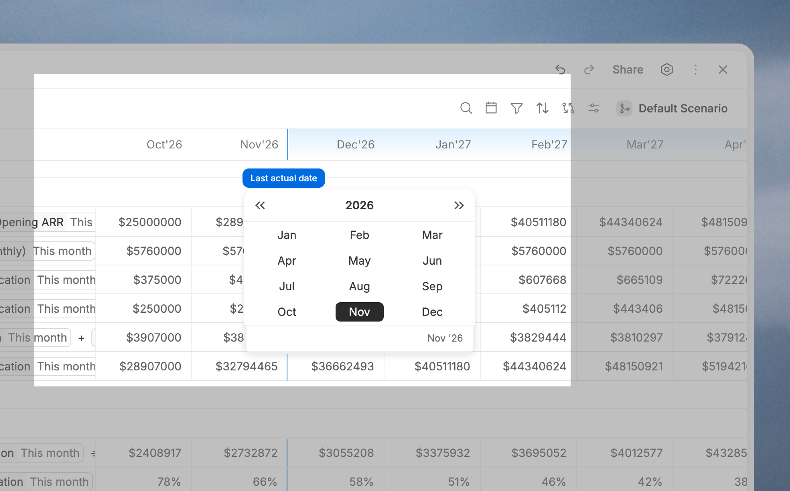

A variable's value in a cell depends on context. The period, the dimension value, the scenario, and any override all affect the result.

## Across the Last actual date

The [Last actual date](/concepts/data-and-structure/time/last-actual-date) is a model setting that splits actual periods from planned periods.

In the model grid, a **Last actual date** marker sits between the last actual period and the first planned period. Click the marker to pick a different month.

<Frame caption="Choosing the Last actual date from the model grid">
  
</Frame>

- Periods up to and including the Last actual date use the variable's **actual formula**.
- Periods after the Last actual date use the variable's **planned formula**.

In the formula editor, these are the **Actual** and **Plan** tabs. For example, `Revenue` can sum invoice amounts from Transactions in actual periods, and use `Units Sold × Price per Unit` in planned periods.

When you close a period, move the Last actual date forward. That period then uses the actual formula. Check the periods on each side of the Last actual date to confirm the switch looks right.

## Period overrides

You can override a single period with a specific value instead of the formula result. Use this for one-off adjustments, such as a planned one-time expense or a signed contract amount.

- Overridden cells are marked in the grid, so you can find them.
- To remove an override, use **Revert to original** on the cell.
- Other periods keep using the formula.

Review overrides when you move the Last actual date. An override can hide a change in the underlying data.

## Across dimensions

When a variable has a [breakdown](/concepts/data-and-structure/variables/variable-breakdown), Oculon calculates it for each dimension value. A formula on the variable applies to every dimension value. See [Using dimensions with variables](/concepts/data-and-structure/dimensions/using-dimensions-with-variables).

## Across scenarios

A variable can hold different values in each [scenario](/concepts/modeling/scenarios/what-is-a-scenario). Values you don't change in a scenario keep following the `Default Scenario`. Values you change become scenario-specific overrides.

## In totals

Quarters, years, and the variable's total row use the variable's **Aggregation** settings. For example, **Sum** adds the months in a quarter, while **Final** shows the last month's value. If a summary looks wrong, check the aggregation before the formula. See [Time aggregation](/concepts/data-and-structure/time/time-aggregation).

## As an input to other variables

One variable can feed many others. A change to a shared driver, such as `Price per Unit`, flows to every formula that references it, and to every view and board that shows those results. See [Variable references](/concepts/data-and-structure/variables/variable-references).

## Related

- [What is a variable](/concepts/data-and-structure/variables/what-is-a-variable)
- [Last actual date](/concepts/data-and-structure/time/last-actual-date)
- [Formula basics](/concepts/modeling/formulas/formula-basics)
- [Time aggregation](/concepts/data-and-structure/time/time-aggregation)
