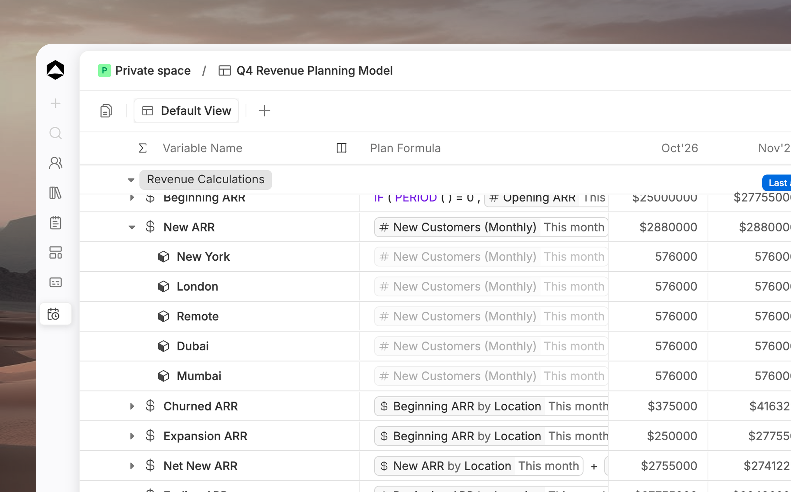
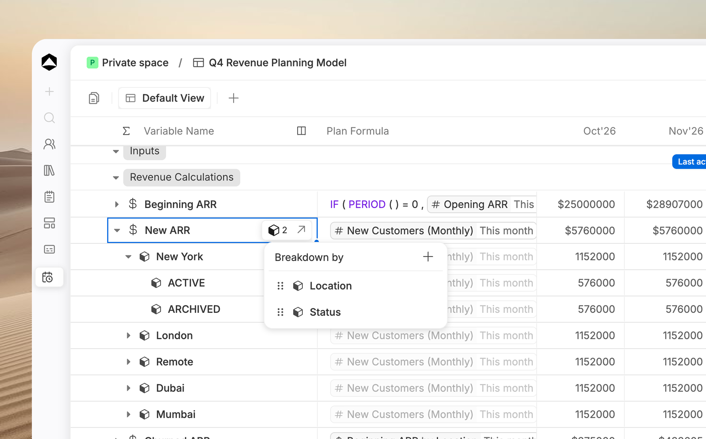

A breakdown splits one variable by the values of a [dimension](/concepts/data-and-structure/dimensions/what-is-a-dimension). For example, you break `New ARR` down by `Location` to hold a separate value for each office, such as `New York` and `London`.

<Frame caption="A variable broken down by one dimension">
  
</Frame>

## Why use a breakdown

- **See the detail.** Find which region, product, or department drives a change.
- **Keep one variable.** Hold all the detail in one variable instead of one variable per category.
- **Write logic once.** A formula on the variable applies to every dimension value.

## Add a dimension to a variable

1. Click the dimension control next to the variable name.
2. In **Breakdown by**, click **+** to add a dimension.
3. Search for a dimension from the Library and select it.

The variable then shows one row for each dimension value. Expand the variable to see them. For more on choosing and attaching dimensions, see [Using dimensions with variables](/concepts/data-and-structure/dimensions/using-dimensions-with-variables).

## Break down by more than one dimension

<Frame caption="A variable broken down by two dimensions">
  
</Frame>

You can add several dimensions to the same variable. Oculon creates a row for each combination of values. For example, `New ARR` broken down by `Location` and `Status` has a row for `ACTIVE` in `New York` and another for `ARCHIVED` in `New York`.

The order of dimensions in **Breakdown by** sets how rows nest. Drag a dimension in the list to change the order.

## Totals

The variable's top row shows the total across its dimension values. You choose how that total is calculated with the **Dimension** setting under **Aggregation**: **Sum**, **Average**, **Initial**, or **Final**. See [Variable formatting](/concepts/data-and-structure/variables/variable-formatting#aggregation).

## Related

- [What is a dimension](/concepts/data-and-structure/dimensions/what-is-a-dimension)
- [Using dimensions with variables](/concepts/data-and-structure/dimensions/using-dimensions-with-variables)
- [Variable formatting](/concepts/data-and-structure/variables/variable-formatting)
- [Variable behavior](/concepts/data-and-structure/variables/variable-behavior)
