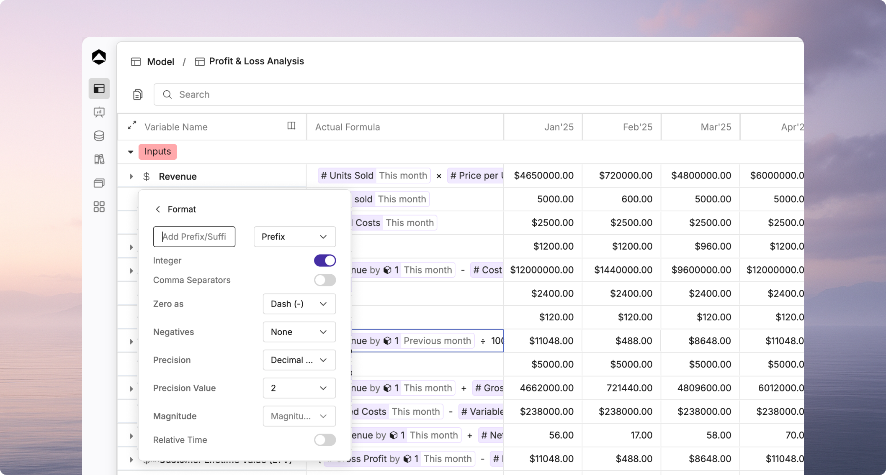

Variable formatting controls how values appear in your model. Use formatting to make numbers easier to scan and to show the right business context at a glance.

<Frame caption="Variable formatting">
  
</Frame>

## Format options

You can customize how values display based on the variable's purpose.

| Option | Description |
| --- | --- |
| **Prefix / suffix** | Add symbols or units such as `Mn`, `Cr`.. |
| **Integer** | Remove decimals for whole-number values. |
| **Comma separators** | Improve readability for large numbers such as `1,000,000`. |
| **Zero handling** | Show zero as a dash or as `0`. |
| **Negatives** | Control how negative values appear. |
| **Precision** | Set the decimal style and number of decimal places. |
| **Magnitude** | Scale values to `k`, `M`, and other larger units. |
| **Relative time** | Adjust how time-based values display. |
| **Currency** | When the variable type is currency, choose the display currency symbol. See [Currency and conversion](/concepts/data-and-structure/variables/currency-and-conversion). |

## Choose formatting that matches the metric

Use formatting that reflects the meaning of the variable. A revenue line should look different from a headcount line or a percentage-based KPI.

## Keep related variables consistent

Use the same formatting rules for similar variables in the same model. Consistent precision, separators, and units make reviews faster and reduce confusion.
