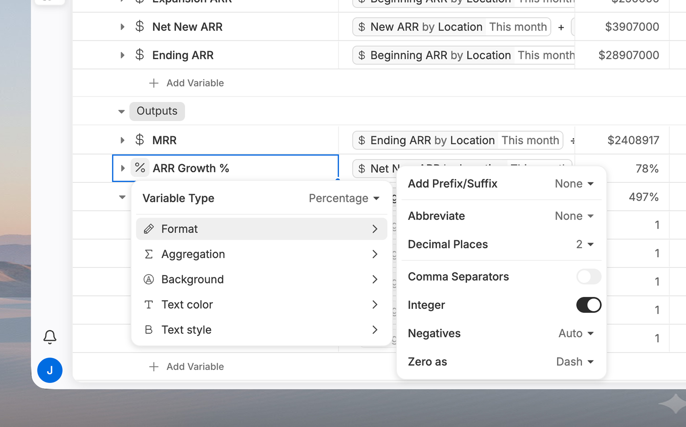

Formatting controls how a variable's values look in the model grid. For example, you can show `Revenue` in millions with no decimals, and show negative values in red.

To open formatting, click the type icon next to the variable name. The menu shows **Variable Type** at the top, followed by **Format**, **Aggregation**, **Background**, **Text color**, and **Text style**.

<Frame caption="Format options for a variable">
  
</Frame>

## Format

| Option | What it does |
| --- | --- |
| **Add Prefix/Suffix** | Adds text before or after each value, such as `Mn` or `units`. |
| **Abbreviate** | Scales values to **Thousand**, **Million**, **Billion**, **Trillion**, **Lakh**, or **Crore**. **Auto** picks a scale for you. |
| **Decimal Places** | Sets how many decimals to show, from `0` to `5`. |
| **Comma Separators** | Groups digits, such as `1,000,000`. |
| **Integer** | Shows values as whole numbers. |
| **Negatives** | Shows negative values in **Red**, in **Accounting** style, or both. |
| **Zero as** | Shows zero as a **Dash** or as **Zero**. |

Formatting changes how values display. It doesn't change the stored values or the results of formulas.

## Aggregation

**Aggregation** sets how a variable's values combine into totals. It has two settings:

- **Time** controls the value shown when months roll up into quarters and years.
- **Dimension** controls the value shown on the variable's total row when it has a [breakdown](/concepts/data-and-structure/variables/variable-breakdown).

Each setting offers **Sum**, **Average**, **Initial**, and **Final**. For example, use **Sum** for `Revenue` and **Final** for `Headcount`, so a year shows closing headcount rather than the sum of twelve months. See [Time aggregation](/concepts/data-and-structure/time/time-aggregation).

## Background, text color, and text style

Use **Background**, **Text color**, and **Text style** (**Bold** or **Italic**) to highlight key lines, such as subtotals or outputs.

## Keep formatting consistent

Match formatting to what the metric means. A revenue line, a headcount line, and a margin should each look different.

Use the same formatting for similar variables in the same model. Consistent decimals, scale, and separators make reviews faster.

## Related

- [Variable types](/concepts/data-and-structure/variables/variable-types)
- [Currency variables](/concepts/data-and-structure/variables/currency-and-conversion)
- [Time aggregation](/concepts/data-and-structure/time/time-aggregation)
- [Variable breakdown](/concepts/data-and-structure/variables/variable-breakdown)
