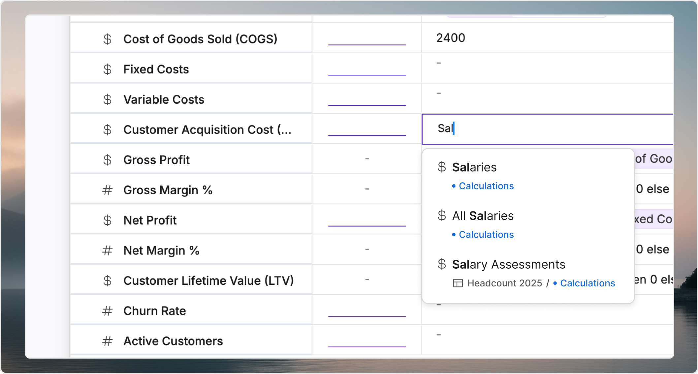
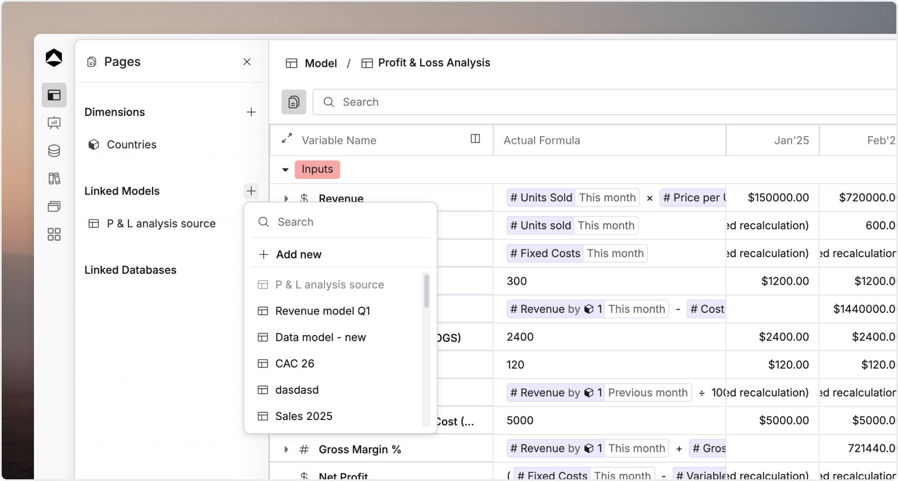

Variable references connect one part of the model to another. Good references make formulas readable and reduce duplicate logic.

<Frame caption="Variable references">
  
</Frame>

## Referencing inside a model

Use clear, stable variable names and rely on autocomplete where available. This reduces typing errors and keeps formulas aligned with the current structure.

## Referencing across linked models

<Frame caption="Linked model references">
  
</Frame>

Oculon can reuse variables from linked models so you do not have to rebuild the same logic in multiple places. Use linked references when a metric should stay centrally owned but still feed another model.

## Keep references intentional

Reference the smallest reliable building block. If a model depends on a single driver, reference that driver directly rather than a broad summary variable that can change for unrelated reasons.

## Review after structure changes

If you rename variables, move sections, or change dimensionality, review dependent formulas and boards. References are easiest to maintain when ownership and naming stay consistent.
