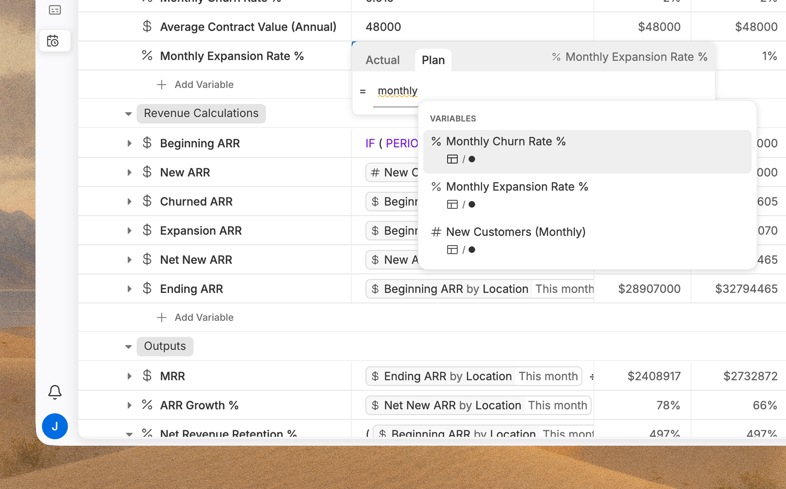

A reference is a variable used inside another variable's formula. For example, `Revenue` references `Units Sold` and `Price per Unit`. References let you define a value once and reuse it everywhere.

This page covers how references work for variables. For formula syntax and functions, see [Formulas](/concepts/modeling/formulas).

## Add a reference

<Frame caption="Searching for a variable to reference">
  
</Frame>

Start typing a variable name in a formula. Oculon suggests matching variables and shows where each one lives. Select a suggestion to insert the reference.

The reference appears as a chip with the variable's type icon and name. If the variable has a breakdown, the chip shows how many dimensions it has.

## Choose which period a reference reads

Each reference reads a period relative to the cell being calculated. By default, it reads `This month`, the same period as the cell.

Click the reference chip to change the period. For example, `Previous month` reads the period before, and `Last 3 months` reads the three periods before. A growth rate might compare `Revenue` at `This month` with `Revenue` at `Previous month`.

These are [relative time](/concepts/data-and-structure/time/relative-time) references. They move with each period, so the formula keeps working as time advances.

## Filter a reference by dimension

When the referenced variable has a breakdown, you can limit the reference to specific dimension values from the same chip. For example, reference only `Revenue` for `EMEA`.

## Reference variables from other models

<Frame caption="Linking another model from the Pages panel">
  
</Frame>

You can reference variables in other models. This keeps a metric owned in one place while it feeds other models. To link a model, open the **Pages** panel, click **+** next to **Linked Models**, and choose the model. For example, a P&L model can read `Salary Assessments` from a headcount model. See [Linked models](/concepts/modeling/models/linked-models).

## Keep references maintainable

- Reference the specific driver you need, not a broad summary that can change for unrelated reasons.
- Prefer stable business names, so references stay easy to read.
- After you change a variable's breakdown or move it between models, check the formulas and boards that use it.

## Related

- [Formula basics](/concepts/modeling/formulas/formula-basics)
- [Relative time](/concepts/data-and-structure/time/relative-time)
- [Linked models](/concepts/modeling/models/linked-models)
- [Variable behavior](/concepts/data-and-structure/variables/variable-behavior)
