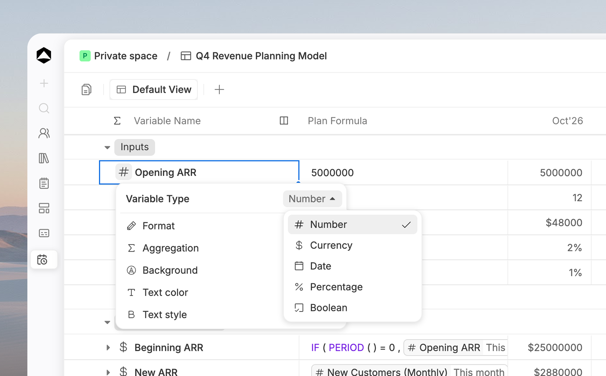

A variable's type tells Oculon what kind of value the variable holds. For example, `Revenue` is a Currency variable, while `Units Sold` is a Number variable.

<Frame caption="Changing a variable's type">
  
</Frame>

## Available types

| Type | Icon | Use it for |
| --- | --- | --- |
| **Number** | `#` | Counts, units, headcount, and other plain numeric values. |
| **Currency** | `$` | Revenue, costs, cash, and other monetary values. |
| **Date** | Calendar | Values that are dates, such as a hire date or contract start. |
| **Percentage** | `%` | Margins, growth rates, conversion rates, and shares. |
| **Boolean** | Checkbox | True or false flags, such as whether a contract is active. |

The type icon appears next to the variable name in the model grid. It also appears on variable references inside formulas.

The same five types apply to variable columns in [Transactions](/concepts/data-and-structure/transactions/transaction-structure) and [dimensions](/concepts/data-and-structure/dimensions/dimension-operations). On a dimension's **+ Add** menu, Number appears as **Variable** and Percentage appears as **Percent**.

## Change a variable's type

1. Click the type icon next to the variable name.
2. In **Variable Type**, choose the new type.

If you choose **Currency**, a **Currency** setting appears so you can pick the currency. See [Currency variables](/concepts/data-and-structure/variables/currency-and-conversion).

## How to choose

Pick the type that matches what the value means, not just how it looks.

- Use **Currency** for anything measured in money, so the currency symbol is always visible.
- Use **Percentage** for ratios and rates, so readers see them as percentages.
- Use **Number** when the value is neither money nor a ratio.

Keep similar variables on the same type. A reviewer can then compare lines in the same section without checking each one.

## Related

- [What is a variable](/concepts/data-and-structure/variables/what-is-a-variable)
- [Variable formatting](/concepts/data-and-structure/variables/variable-formatting)
- [Currency variables](/concepts/data-and-structure/variables/currency-and-conversion)
