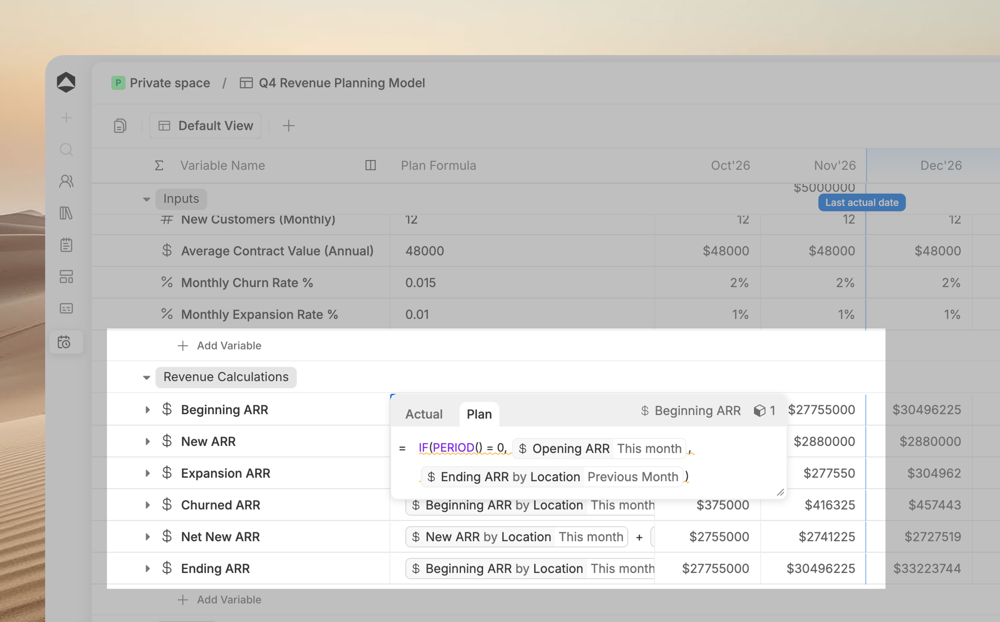

A variable is one line in a model that holds input values, a formula, or both. For example, a revenue model might have `Units Sold` and `Price per Unit` as inputs, and `Revenue` as a calculated line that multiplies them.

<Frame caption="A variable's actual and planned formulas">
  
</Frame>

## What a variable does

Each variable has a value for every period in the model's date range. You can enter those values yourself, calculate them with a formula, or combine both.

Variables are what the rest of Oculon reads:

- Formulas reference other variables to calculate results.
- Views and boards display variables for analysis and reporting.
- Transactions feed variables through their actual formulas.
- Transactions and dimensions can also hold their own variable columns, such as `MRR` per customer or `Monthly Rent` per location.
- Scenarios hold alternative values for the same variables.

Because each variable is defined once, every report that uses it shows the same number.

## Parts of a variable

| Part | What it does |
| --- | --- |
| **Name** | Identifies the variable in the grid, in formulas, and in reports. |
| **Type** | Sets what kind of value the variable holds: Number, Currency, Date, Percentage, or Boolean. The type icon appears next to the name. See [Variable types](/concepts/data-and-structure/variables/variable-types). |
| **Breakdown** | The dimensions the variable is split by, such as `Region` or `Product`. See [Variable breakdown](/concepts/data-and-structure/variables/variable-breakdown). |
| **Trend** | A sparkline in the **Trend** column that shows how values move over time. |
| **Actual formula** | How the variable calculates for periods up to and including the [Last actual date](/concepts/data-and-structure/time/last-actual-date). |
| **Planned formula** | How the variable calculates for periods after the Last actual date. The formula editor labels this tab **Plan**. |
| **Time values** | The value in each period column. You can override a single period with a specific value. |
| **Formatting** | How values display, such as decimal places or a currency symbol. See [Variable formatting](/concepts/data-and-structure/variables/variable-formatting). |

You can show or hide the **Trend**, **Actual Formula**, and **Plan Formula** columns in the model grid.

## Actual and planned formulas

One variable can show both history and forecast. The actual formula usually reads from source data, such as summing invoice amounts from Transactions. The planned formula usually combines drivers and assumptions, such as `Units Sold × Price per Unit`.

When you move the Last actual date forward, more periods switch to the actual formula. See [Variable behavior](/concepts/data-and-structure/variables/variable-behavior) for details.

## Related

- [Variable types](/concepts/data-and-structure/variables/variable-types)
- [Variable behavior](/concepts/data-and-structure/variables/variable-behavior)
- [Formula basics](/concepts/modeling/formulas/formula-basics)
- [How data flows through Oculon](/concepts/core-concepts/how-data-flows-through-oculon)
