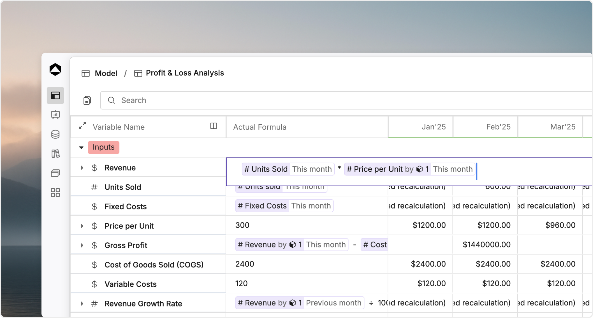

Formulas tell Oculon how a variable should calculate. They connect inputs, assumptions, and business rules so the model can update results consistently across time and dimension context.

<Frame caption="Formula editor">
  
</Frame>

Most planning models use both an **actual formula** and a **planned formula**, split by the [Last actual date](/concepts/data-and-structure/time/last-actual-date).

## In this section

<Columns cols={2}>
  <Card title="Formula basics" icon="circle-help" href="/concepts/modeling/formulas/formula-basics">
    What formulas do and how context changes results.
  </Card>
  <Card title="Formula editor" icon="pencil" href="/concepts/modeling/formulas/formula-editor">
    Write and review formulas on the source variable.
  </Card>
  <Card title="Functions" icon="sigma" href="/concepts/modeling/formulas/functions">
    Operators, logical branches, and math helpers.
  </Card>
  <Card title="Conditional logic" icon="git-branch" href="/concepts/modeling/formulas/conditional-logic">
    Branch formulas for cutoffs, seasonality, and exceptions.
  </Card>
  <Card title="Helper variables and modifiers" icon="workflow" href="/concepts/modeling/formulas/helper-variables-and-modifiers">
    Keep formulas readable with helpers and time context.
  </Card>
  <Card title="Common formula patterns" icon="copy" href="/concepts/modeling/formulas/common-formula-patterns">
    Reusable patterns for planning and allocation.
  </Card>
  <Card title="Formula errors" icon="triangle-alert" href="/concepts/modeling/formulas/formula-errors">
    Diagnose wrong numbers, blanks, and cutoff mistakes.
  </Card>
  <Card title="Formula best practices" icon="badge-check" href="/concepts/modeling/formulas/formula-best-practices">
    Habits that keep formulas reviewable and stable.
  </Card>
</Columns>

## Related

- [Variable references](/concepts/data-and-structure/variables/variable-references)
- [Time in Oculon](/concepts/data-and-structure/time/time-in-oculon)
- [Last actual date](/concepts/data-and-structure/time/last-actual-date)
