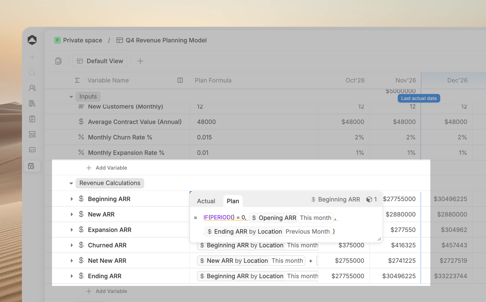

The formula editor is where you create and review calculation logic on a variable. It is also the fastest place to audit a number when a board, view, or scenario result does not look right.

<Frame caption="Formula editor on a model variable">
  
</Frame>

## What you do in the editor

In the formula editor, you can:

- write or update a variable's formula
- reference other variables
- use built-in helpers and functions
- review how a formula behaves in context
- compare whether the logic is appropriate for the `actual formula` or `planned formula`

## Open the right formula first

Start from the source variable, not the board that exposed the issue.

Use this workflow:

1. Identify the variable that owns the calculation.
2. Show formulas if the formula column is hidden. You can use `Cmd/Ctrl + Shift + \`` to show formulas.
3. Select the relevant formula cell on the variable.
4. Review the formula text before you change anything else.

This keeps your debugging inside the model where the logic actually lives.

## A practical editing workflow

Once the formula is open:

1. Confirm you are editing the correct variable.
2. Check whether you are working on the `actual formula` or `planned formula`.
3. Type the expression or select references from autocomplete.
4. Review the result in the model grid at the exact time and dimension context that matters.
5. Refine the logic until the output matches the business rule.

If the same formula needs to behave differently around the [`Last actual date`](/concepts/data-and-structure/time/last-actual-date), make that split explicit instead of hiding it inside a hard-to-read branch.

## Use the editor for review, not just creation

The editor is not only for writing formulas. It is also the best place to review:

- whether references still point to the intended variables
- whether the formula is using the right helper variables
- whether the result changes correctly across time
- whether a summary issue is really caused by aggregation instead of the base formula

## When to stop editing in place

If the formula becomes difficult to scan, stop and simplify it.

Good signs that you should switch to [Helper variables and modifiers](/concepts/modeling/formulas/helper-variables-and-modifiers) include:

- several nested conditions
- repeated references to the same business rule
- separate logic for seasonality, cutoff handling, and overrides in one line
- formulas that are easy to break but hard to explain

## Related pages

- [Formula basics](/concepts/modeling/formulas/formula-basics)
- [Conditional logic](/concepts/modeling/formulas/conditional-logic)
- [Formula errors](/concepts/modeling/formulas/formula-errors)
- [Formula issues](/concepts/resources/troubleshooting)
