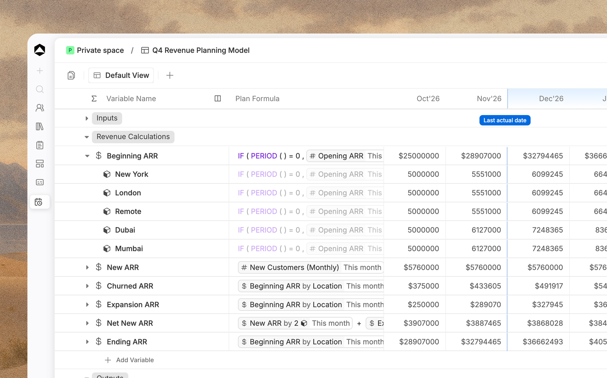

A model is the core planning workspace in Oculon. It brings together variables, formulas, time settings, dimensions, scenarios, and linked data so you can build and review planning logic in one place.

Open models from Library (via the **FP&A** experience), or create one with **Create Model**.

<Frame caption="A model in Oculon">
  
</Frame>

## In this section

<Columns cols={2}>
  <Card title="What is a model" icon="circle-question-mark" href="/concepts/modeling/models/what-is-a-model">
    How models relate to variables, Transactions, views, and boards.
  </Card>
  <Card title="Model structure" icon="folder-tree" href="/concepts/modeling/models/model-structure">
    Sections, variables, helpers, and outputs.
  </Card>
  <Card title="Model settings" icon="settings" href="/concepts/modeling/models/model-settings">
    Date range, granularity, Last actual date, and fiscal assumptions.
  </Card>
  <Card title="Model History" icon="clock-fading" href="/concepts/modeling/models/model-history">
    Preview and restore model checkpoints.
  </Card>
  <Card title="Linked models" icon="git-branch" href="/concepts/modeling/models/linked-models">
    Reuse planning logic across related models.
  </Card>
  <Card title="Model best practices" icon="badge-check" href="/concepts/modeling/models/model-best-practices">
    Keep models clear, scalable, and easy to hand off.
  </Card>
</Columns>

## Related

- [Variables](/concepts/data-and-structure/variables)
- [Time](/concepts/data-and-structure/time)
- [Formulas](/concepts/modeling/formulas)
- [Scenarios](/concepts/modeling/scenarios)
- [Versioning](/concepts/modeling/models/model-history) (Concepts Legacy; not yet a Concepts child)
