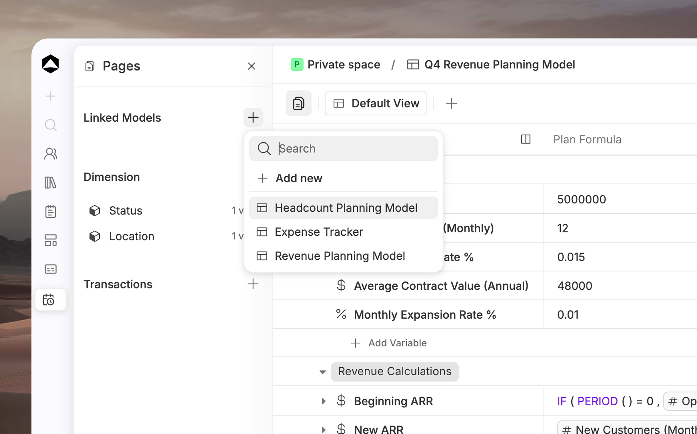

Linked models let you reuse planning logic across separate models without duplicating the same work.

<Frame caption="Linking another model from the Pages panel">
  
</Frame>

## When to link models

Link models when:

- one team owns a source plan that another team depends on
- a shared driver should stay centrally controlled
- you want a modular planning setup instead of one oversized model

## What good linking looks like

Keep ownership clear. The source model should own the metric. The receiving model should consume it, not redefine it with slightly different logic.

## What to review after a change

A linked model setup is powerful, but it also creates dependencies. Recheck critical links after:

- structural changes in the source model
- changes to model settings that affect time behavior
- major scenario work or version restores

If a downstream result looks wrong, confirm the link before rewriting formulas.

## Related pages

- [Model structure](/concepts/modeling/models/model-structure)
- [Versioning](/concepts/modeling/models/model-history)
- [Variable references](/concepts/data-and-structure/variables/variable-references)
