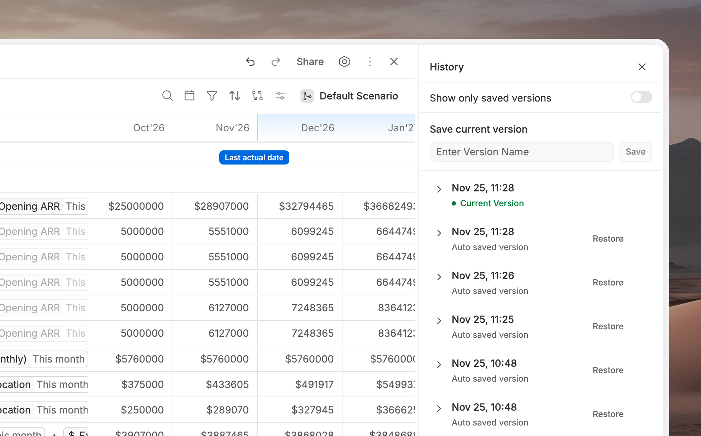

Model **History** lets you preview earlier checkpoints in the same model and restore a previous version when you need to roll back carefully.

History is model-scoped. It is not a workspace-wide History product. Artifact history is a separate surface when Artifacts are enabled.

## Open History

In a model, open **History** from the model toolbar. The History panel lists checkpoints for the current model.

<Frame caption="The History panel in a model">
  
</Frame>

The panel lists automatic checkpoints as **Auto saved version**. To keep a named checkpoint, type a name under **Save current version** and click **Save**. Turn on **Show only saved versions** to hide the automatic ones.

## Preview a version

Select a checkpoint to preview it. While previewing, the product indicates that you are previewing a version so you do not confuse the checkpoint with the live editable model state.

## Restore a version

If you have edit permission, you can restore a checkpoint. Recheck key outputs that other teams depend on before you rely on the restored model widely again.

View-only users can preview but cannot restore.

## When History helps

Use History when you want to:

- preserve a trusted baseline before a large change
- compare current work to an earlier checkpoint
- recover carefully after a change caused problems

History works best when the model structure is still recognizable across checkpoints. After major structure, dependency, or time-setting changes, compare results carefully before you treat an older checkpoint as a clean baseline.

## Related history surfaces

| Surface | Where it lives | Purpose |
| :--- | :--- | :--- |
| Model **History** | Models | Checkpoint preview and restore |
| Artifact history | Artifacts (when enabled) | Artifact-specific history |

Do not assume these surfaces share one History parent or one restore model.

## Related pages

- [Model settings](/concepts/modeling/models/model-settings)
- [What is a model](/concepts/modeling/models/what-is-a-model)
- [Scenario sync behavior](/concepts/modeling/scenarios/scenario-sync-behavior)
