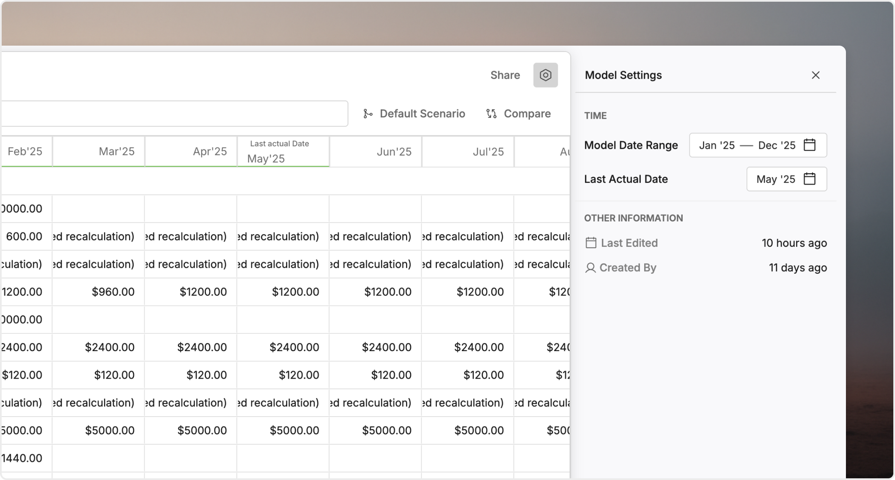

Model settings define the rules the rest of the model depends on. They control the planning horizon, the time structure, and the model-wide assumptions other logic inherits.

<Frame caption="Model time settings">
  
</Frame>

## Core settings to confirm early

- model date range
- [Time granularity](/concepts/data-and-structure/time/time-granularity)
- [Last actual date](/concepts/data-and-structure/time/last-actual-date)
- fiscal year assumptions

These settings should be stable before you build deep logic, publish boards, or compare scenarios widely.

## Why these settings matter

Changing a model setting later can affect formulas, views, boards, and comparisons. For example:

- the date range changes which periods exist in the model
- the granularity changes how often values are stored and reviewed
- the `Last actual date` changes where `actual formula` and `planned formula` behavior split
- fiscal year assumptions affect quarter and year summaries

## Use this page as the hub, not the deep dive

For time-related behavior, start with [Time in Oculon](/concepts/data-and-structure/time/time-in-oculon) and then review the specific pages for:

- [Time granularity](/concepts/data-and-structure/time/time-granularity)
- [Last actual date](/concepts/data-and-structure/time/last-actual-date)
- [Relative time](/concepts/data-and-structure/time/relative-time)
- [Time aggregation](/concepts/data-and-structure/time/time-aggregation)
- [Time rollups](/concepts/data-and-structure/time/time-aggregation)

## What to check when a model behaves unexpectedly

If a model starts to behave unexpectedly, check the settings before you rewrite formulas. Many issues start with a model-wide assumption that changed quietly over time.

## Related model tools

- Use **History** in the model to preview checkpoints when you need to review an earlier state. A dedicated Concepts page for Model History is not in the current target IA yet.
- Confirm scenario context in the scenario switcher before you edit. See [What is a scenario](/concepts/modeling/scenarios/what-is-a-scenario).
