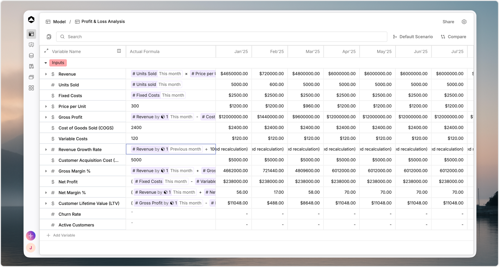

A model is the core planning workspace in Oculon. You typically open models from Library under the **FP&A** app experience, or create one with **Create Model**. It brings together variables, formulas, time settings, dimensions, scenarios, and linked data so you can build and review planning logic in one place.

<Frame caption="Model details">
  
</Frame>

## What lives in a model

A model usually includes:

- input variables and business assumptions
- calculated logic and outputs
- a model date range and time granularity
- dimensions where extra analysis is needed
- scenario-ready planning structure

The model is where planning logic becomes reusable. If you build it well once, the same structure can support reporting, scenario review, and board-level communication.

## Model versus other surfaces

Each planning surface in Oculon serves a different purpose:

- use [Transactions](/concepts/data-and-structure/transactions/what-is-a-transaction) (documented as Databases) for source records and row-level detail
- use a [variable](/concepts/data-and-structure/variables/what-is-a-variable) for one metric or assumption inside the model
- use a [board](/concepts/analysis-and-reporting/boards/what-is-a-board) to present and monitor results
- use a [view](/concepts/analysis-and-reporting/views/what-is-a-view) to filter, group, and compare outputs

The model is the layer that connects those pieces into one planning system.

## Why models matter

A model gives teams one place to define how the business plan should behave. That matters because formulas, reporting, scenario work, and review workflows all depend on the same underlying logic.

## Related pages

- [Model structure](/concepts/modeling/models/model-structure)
- [Model settings](/concepts/modeling/models/model-settings)
- [Linked models](/concepts/modeling/models/linked-models)
