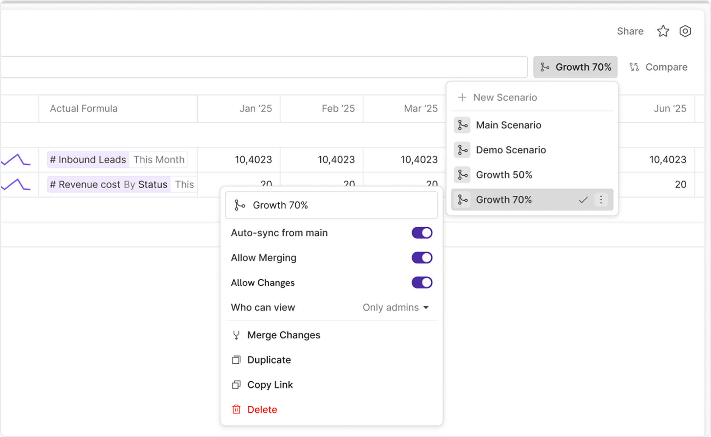

A scenario is a named branch of a model that lets you test changes without replacing the current baseline. Use scenarios to explore alternatives, review proposed changes, and keep an approved plan intact while work continues elsewhere.

The product default branch is **Default Scenario** (older docs sometimes say Main Scenario).

<Frame caption="Scenarios">
  
</Frame>

## In this section

<Columns cols={2}>
  <Card title="What is a scenario" icon="circle-help" href="/concepts/modeling/scenarios/what-is-a-scenario">
    Branching mental model and core scenario concepts.
  </Card>
  <Card title="Create and manage scenarios" icon="pencil" href="/concepts/modeling/scenarios/create-and-manage-scenarios">
    Create, switch, duplicate, name, and share scenario context.
  </Card>
  <Card title="Scenario sync behavior" icon="refresh-cw" href="/concepts/modeling/scenarios/scenario-sync-behavior">
    How inherited values follow Default Scenario until overridden.
  </Card>
  <Card title="Scenario overrides" icon="sliders-horizontal" href="/concepts/modeling/scenarios/scenario-overrides">
    Make scenario-specific changes and reset them when needed.
  </Card>
  <Card title="Scenario governance and access" icon="shield-check" href="/concepts/modeling/scenarios/scenario-governance-and-access">
    Allow Changes, Allow Merging, Share, and delete safeguards.
  </Card>
  <Card title="Merge scenarios" icon="git-merge" href="/concepts/modeling/scenarios/merge-scenarios">
    Move approved overrides into Default Scenario with Merge Changes.
  </Card>
  <Card title="Versioning and snapshots" icon="history" href="/concepts/modeling/scenarios/versioning-and-snapshots">
    Preserve reference states for later review.
  </Card>
  <Card title="Scenario best practices" icon="badge-check" href="/concepts/modeling/scenarios/scenario-best-practices">
    Keep scenario work safe, reviewable, and easy to explain.
  </Card>
</Columns>

## Related

- [Scenario compare](/concepts/analysis-and-reporting/compare/scenario-compare)
- [Models](/concepts/modeling/models)
