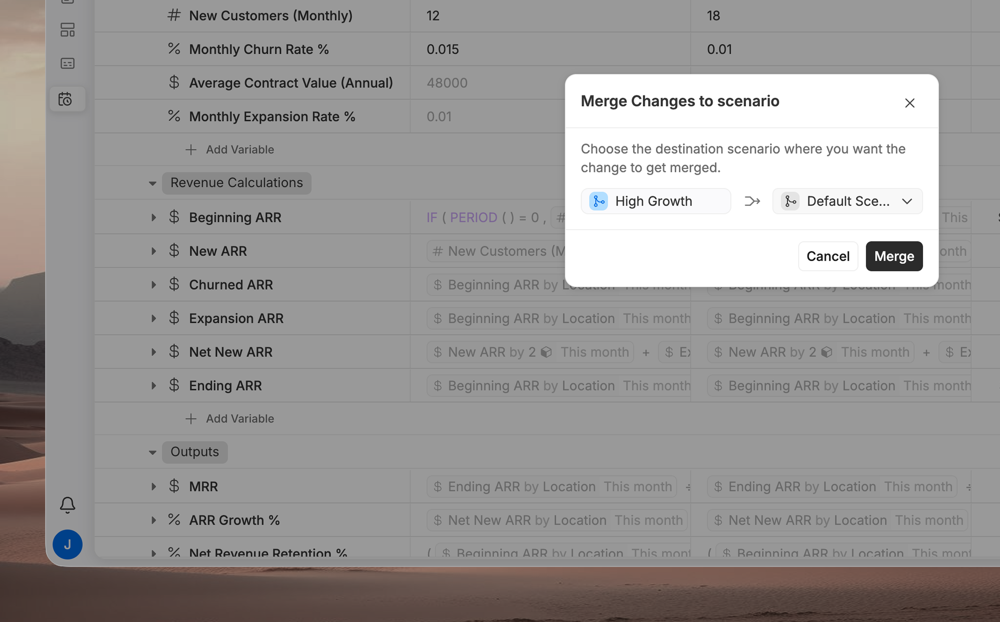

**Merge Changes** is the explicit workflow that moves scenario-local overrides from a source scenario into a destination scenario. It is available from **Manage Scenario** on a non-default scenario when you have edit access and **Allow Merging** is on.

Merge is user-facing and directional. It is not the same as duplicating a scenario.

<Frame caption="Merge scenario changes into Default Scenario">
  
</Frame>

## What merge does

In the current product model:

- merge is directional (source → destination)
- source and destination are explicit in the **Merge Changes to scenario** dialog
- a scenario cannot merge into itself
- merge moves scenario-local overrides; it is not a full snapshot copy of everything you see

Duplication creates a new branch. Merge adopts local differences into another branch.

## Current destination support

Today the merge dialog offers **Default Scenario** as the destination.

Other destinations are not offered in the current UI. Document merge as adopting approved overrides back into the shared baseline (**Default Scenario**), not as a free-form merge between any two branches.

## How to merge

1. Confirm you are on the intended source scenario.
2. Compare the scenario against the baseline you care about. See [Scenario compare](/concepts/analysis-and-reporting/compare/scenario-compare).
3. Confirm **Allow Merging** is on for the source. See [Scenario governance and access](/concepts/modeling/scenarios/scenario-governance-and-access).
4. Open **Manage Scenario** → **Merge changes**.
5. In **Merge Changes to scenario**, confirm the source and destination, then click **Merge**.

**Merge changes** is disabled when **Allow Merging** is off. The action is not available on **Default Scenario** (Default is the destination, not a merge source in this flow).

## Access expectations

Before you merge:

- you need edit access on the source scenario
- **Allow Merging** must be enabled on the source
- the destination must be writable in the product sense (**Default Scenario** in the current dialog)
- you should have access to both scenarios involved

If merge fails, the product shows an error state. Resolve access or scenario state, then try again.

## Compare before you merge

The safest pattern is:

1. keep overrides focused
2. compare against the right baseline
3. confirm the source is still intended
4. run **Merge Changes**

## Limitations

- Destination choice is currently limited to **Default Scenario**
- Do not assume merge copies every visible grid value beyond scenario-local overrides
- Do not document unconfirmed conflict-resolution UX beyond success/error feedback

## Related pages

- [Scenario governance and access](/concepts/modeling/scenarios/scenario-governance-and-access)
- [Scenario overrides](/concepts/modeling/scenarios/scenario-overrides)
- [Scenario compare](/concepts/analysis-and-reporting/compare/scenario-compare)
- [Scenario best practices](/concepts/modeling/scenarios/scenario-best-practices)
