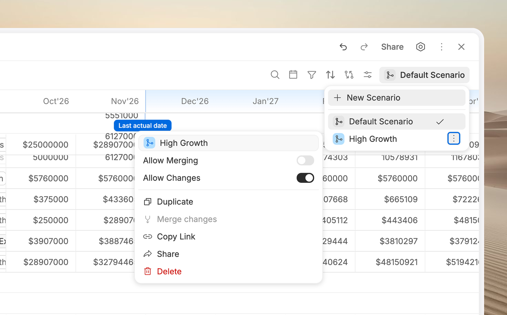

A scenario is a named branch of a model that lets you test changes without replacing the current baseline. In Oculon, scenarios are designed for safe experimentation, controlled review, and approved changes that can later flow back into `Default Scenario`.

<Frame caption="Scenario switcher in a model">
  
</Frame>

## Why scenarios matter

Scenarios help teams move quickly without putting the live planning baseline at risk.

They are useful when you need to:

- test a new assumption set
- preserve an approved baseline
- compare alternatives before making a decision
- isolate risky changes until they are reviewed

## The branching mental model

Scenarios work best when you think about them as branches of the same model.

- `Default Scenario` is the primary working branch.
- Other scenarios are derived branches.
- Local edits become scenario-specific overrides.
- Approved changes can later be merged back into another scenario.

This matters because the model structure remains shared. A scenario changes the values, logic, or settings that differ in that branch. It is not meant to be a full separate model copy for every idea.

## Default Scenario versus derived scenarios

`Default Scenario` is the default reference state for the model.

Most new scenarios begin from `Default Scenario`, and teams often treat it as the safest shared baseline. In the current product story, `Default Scenario` is always available and is the most common destination when users later run `Merge Changes`.

Derived scenarios are where you:

- make exploratory edits
- create draft alternatives
- preserve a reviewed branch
- continue work from an already approved baseline

## What scenarios are not

A scenario is not the same as duplicating a whole model for every planning idea.

If the structure, time setup, formulas, and reporting surfaces are still meant to stay shared, a scenario is usually the right tool. If the work needs an entirely separate model structure, that is a different decision.

## Common scenario use cases

Typical scenario workflows include:

- budget versus latest forecast
- hiring freeze or expansion cases
- pricing or volume sensitivity analysis
- board-approved baseline versus working draft
- keeping one locked baseline while planning continues in a separate branch

## Core scenario concepts

There are four concepts to understand early:

- `Default Scenario`: the default branch
- `override`: a local scenario-specific change
- inheritance: non-overridden values continue to follow `Default Scenario`
- `Merge Changes`: a directional action that moves approved overrides into another scenario

Once those concepts are clear, the rest of the scenario workflow becomes much easier to trust.

## Related pages

- [Create and manage scenarios](/concepts/modeling/scenarios/create-and-manage-scenarios)
- [Scenario sync behavior](/concepts/modeling/scenarios/scenario-sync-behavior)
- [Scenario overrides](/concepts/modeling/scenarios/scenario-overrides)
- [Merge scenarios](/concepts/modeling/scenarios/merge-scenarios)
- [Scenario compare](/concepts/analysis-and-reporting/compare/scenario-compare)
- [Scenario governance and access](/concepts/modeling/scenarios/scenario-governance-and-access)
