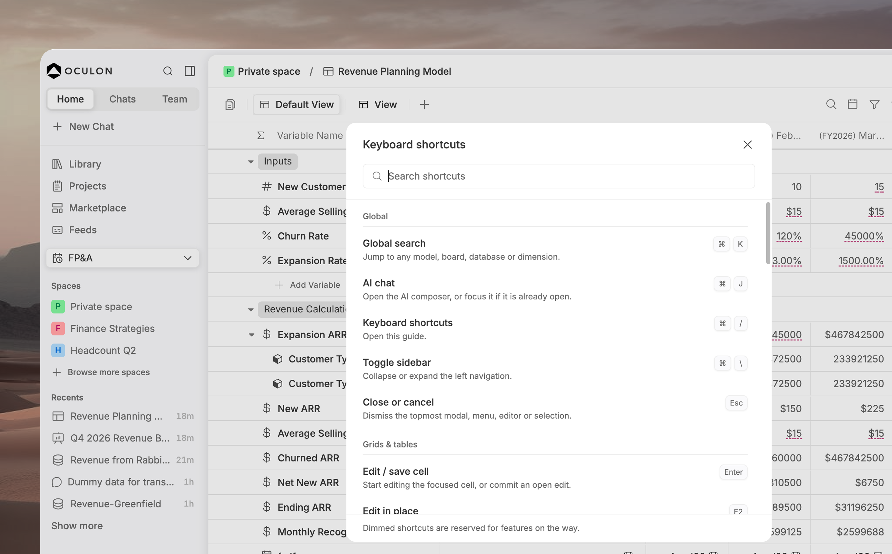

Keyboard shortcuts speed up search, navigation, grid editing, and common editing actions. Open the in-product guide anytime with `Cmd/Ctrl + /`.

<Frame caption="Keyboard shortcuts guide">
  
</Frame>

## Key notation

| Key | Description |
| :--- | :--- |
| `Cmd` | Command on Mac |
| `Ctrl` | Control on Windows |
| `Shift` | Shift |
| `Enter` | Return or Enter |
| `Esc` | Escape |

Where you see `Cmd/Ctrl`, use Command on Mac and Control on Windows.

## Global

| Shortcut | Action |
| :--- | :--- |
| `Cmd/Ctrl + K` | Open global search / the command palette (jump to models, boards, Transactions, dimensions, and quick actions) |
| `Cmd/Ctrl + J` | Open the AI composer, or focus it if it is already open |
| `Cmd/Ctrl + /` | Open or close this keyboard shortcuts guide |
| `Cmd/Ctrl + \` | Collapse or expand the left sidebar |
| `Esc` | Dismiss the topmost modal, menu, editor, or selection |

The collapsed sidebar Search control uses the same palette as `Cmd/Ctrl + K`. See [Sidebar and search](/concepts/resources/sidebar-and-search).

## Grids (models and Transactions)

These shortcuts apply in model and Transactions grids when focus is not inside a text field or open editor.

| Shortcut | Action |
| :--- | :--- |
| `Enter` | Start editing the focused cell, or commit an open edit |
| `F2` | Edit the focused cell in place |
| `Esc` | Cancel the current edit |
| `Tab` / `Shift + Tab` | Move between cells |
| `Cmd/Ctrl + C` / `X` / `V` | Copy, cut, and paste |
| `Cmd/Ctrl + Shift + V` | Paste values only (model cells that carry both formula and value) |
| `Cmd/Ctrl + Z` | Undo |
| `Cmd/Ctrl + Shift + Z` or `Cmd/Ctrl + Y` | Redo |
| `Delete` | Delete the selected row or variable where you have permission |

Typing into a focused text field, formula editor, or content-editable surface disables most grid shortcuts so the field can receive keys normally.

Dimmed shortcuts in the product guide are reserved for features that are not available yet.

## Formula editor

| Shortcut | Action |
| :--- | :--- |
| `Enter` | Save the formula |
| `Shift + Enter` | Insert a new line |
| `Esc` | Cancel without saving |

## Boards and AI chat

| Shortcut | Context | Action |
| :--- | :--- | :--- |
| `/` | Board canvas or AI chat input | Open the slash / skills menu when that surface supports it |
| `Enter` | AI chat | Send the message |
| `Esc` | AI chat while streaming | Stop the current response |

## Related pages

- [Sidebar and search](/concepts/resources/sidebar-and-search)
- [Troubleshooting](/concepts/resources/troubleshooting)
