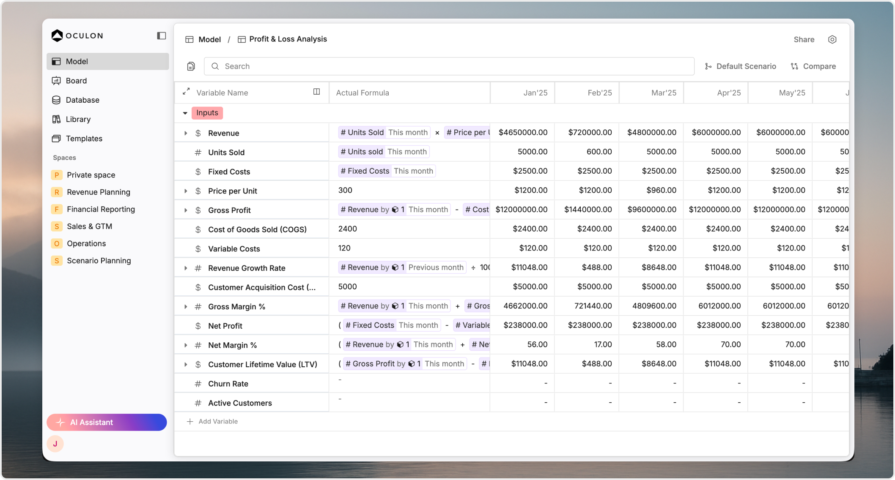

The sidebar is the main way to move between Spaces, Library resources, AI chat, and Settings. Search and the command palette jump you to a known item without drilling the tree.

<Frame caption="Sidebar navigation">
  
</Frame>

## Workspace navigation

At the workspace level you typically see:

| Area | What it is for |
| :--- | :--- |
| **Home / Spaces tab** | Day-to-day navigation across Spaces and quick lists |
| **Chats tab** | AI conversation history and related chat entry points |
| **New Chat** | Start a full-screen AI chat |
| **Library** | Browse models, boards, Transactions, and related library views |
| **App switcher** | Switch product surfaces when more than one app mode is available |
| **Profile / Settings** | Open [Personal settings](/concepts/settings-and-administration/personal-settings) and, for owners, [Workspace settings](/concepts/settings-and-administration/workspace-settings) |

Exact labels can vary slightly by role and environment. Treat this as a map, not a pixel-perfect screenshot guide.

## Spaces and private space

Under Home, **Spaces** organize shared teamspaces and your Private Space. Use them to keep models, boards, and Transactions findable by team. See [Teamspaces and private space](/concepts/workspace-and-collaboration/teamspaces-and-private-space).

**Recents** (and similar quick lists) surface items you opened recently. Keep favorites and naming intentional so the list stays useful.

## Primary product areas

From the sidebar and Library you reach the main Concepts modules:

| Surface | Concepts home |
| :--- | :--- |
| Models | [Models](/concepts/modeling/models) |
| Transactions | [Transactions](/concepts/data-and-structure/transactions) |
| Boards | [Boards](/concepts/analysis-and-reporting/boards) |
| Dimensions (library) | [Dimensions](/concepts/data-and-structure/dimensions) |
| AI assistant / agents | [AI overview](/concepts/ai-and-agents/ai-overview) |
| Workspaces | [Workspaces](/concepts/workspace-and-collaboration/workspaces) |

## Availability-dependent navigation

Some sidebar destinations appear only when enabled for your environment. Do not treat them as universally available:

- [Projects](/concepts/workspace-and-collaboration/projects-and-tasks)
- [Feed](/concepts/ai-and-agents/feed)
- Templates
- Artifacts

If you do not see an item, it may be feature-gated or outside your plan. See availability notes on those Concepts pages.

## Settings

Open Settings from the profile menu.

- **My Account** — every user. See [Personal settings](/concepts/settings-and-administration/personal-settings).
- **Admin** — Workspace Owners. See [Workspace settings](/concepts/settings-and-administration/workspace-settings).

## Search and command palette

Press `Cmd/Ctrl + K` (or use the sidebar Search control) to open the command palette.

Confirmed user-facing behavior:

- Search across workspace items such as models, boards, Transactions, and related destinations
- Jump to Library destinations (for example Models, Boards, Transactions)
- Run quick actions such as **Start a new chat** and **Create model**
- Open a result in a new tab with `Cmd/Ctrl + click` when the palette shows that hint
- Filter result types when filters are shown in the palette UI

Flag-gated destinations (Templates, Artifacts, and similar) appear in the palette only when those features are enabled.

The palette is for known-item navigation and a small set of create/jump actions. It is not a full admin console and does not replace Settings.

## Related pages

- [Keyboard shortcuts](/concepts/resources/keyboard-shortcuts)
- [How Oculon is organized](/concepts/core-concepts/how-oculon-is-organized)
- [Troubleshooting](/concepts/resources/troubleshooting)
