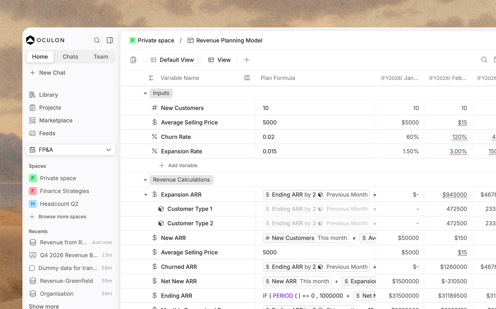

The sidebar is the main way to move between Home, Chats, Team, Library resources, Spaces, and Settings. Search and the command palette jump you to a known item without drilling the tree.

<Frame caption="Sidebar navigation">
  
</Frame>

## Layout at a glance

Top to bottom, the expanded sidebar usually includes:

1. **Header** — Oculon logo, **Search**, and collapse control  
2. **Home / Chats / Team** segmented tabs  
3. **New Chat** (on Home and Chats)  
4. **Primary destinations** — Library and other workspace destinations when enabled  
5. **App switcher** — for example **FP&A**, when more than one app surface is available  
6. **Spaces** — Private Space, shared teamspaces, and **Browse more spaces**  
7. **Recents** — items you opened recently, with **Show more** when the list is long  
8. **Profile** — avatar and menu for settings, invite, and switch workspace  

Collapse the sidebar with the header control or `Cmd/Ctrl + \` to keep only icon shortcuts. See [Keyboard shortcuts](/concepts/resources/keyboard-shortcuts).

## Home, Chats, and Team

| Tab | What it is for |
| :--- | :--- |
| **Home** | Day-to-day navigation: Library destinations, app switcher, Spaces, and Recents |
| **Chats** | AI conversation history and chat entry points |
| **Team** | Team and agent collaboration surfaces when that mode is available |

**New Chat** starts a full-screen AI chat. It stays available from Home and Chats.

## Primary destinations

On **Home**, the list under **New Chat** is the main jump list:

| Destination | What it is for |
| :--- | :--- |
| **Library** | Browse models, boards, Transactions, dimensions, and related library views |
| **Projects** | Project work when Projects is enabled in your environment |
| **Marketplace** | Discover shared templates or marketplace content when available |
| **Feeds** | Activity and feed surfaces when Feeds is enabled |

Exact items depend on role and feature flags. Treat the screenshot as the current layout; if you do not see a destination, it may be gated for your workspace. Artifacts, when available, live under Library rather than as a separate sidebar row.

From Library you reach the main Concepts modules:

| Surface | Concepts home |
| :--- | :--- |
| Models | [Models](/concepts/modeling/models) |
| Transactions | [Transactions](/concepts/data-and-structure/transactions) |
| Boards | [Boards](/concepts/analysis-and-reporting/boards) |
| Dimensions | [Dimensions](/concepts/data-and-structure/dimensions) |
| AI assistant / agents | [AI overview](/concepts/ai-and-agents/ai-overview) |
| Workspaces | [Workspaces](/concepts/workspace-and-collaboration/workspaces) |

## App switcher

Below the primary destinations, the **app switcher** (for example **FP&A**) switches product surfaces when your account has more than one app mode. Spaces and Recents below it follow the active app context.

## Spaces and Recents

**Spaces** lists your **Private Space** and shared teamspaces. Use **Browse more spaces** to find or join additional teamspaces. See [Teamspaces and private space](/concepts/workspace-and-collaboration/teamspaces-and-private-space).

**Recents** lists models, boards, Transactions, and other items you opened recently. Keep naming clear so the list stays useful; use **Show more** when you need older entries.

## Settings and profile

Open Settings from the **profile** menu at the bottom of the sidebar.

- **My Account** — every user. See [Personal settings](/concepts/settings-and-administration/personal-settings).
- **Admin** — Workspace Owners. See [Workspace settings](/concepts/settings-and-administration/workspace-settings).

The same menu includes **Switch Workspace**, **Invite users**, and related account actions. See [Workspaces](/concepts/workspace-and-collaboration/workspaces).

## Search and command palette

Press `Cmd/Ctrl + K` (or use the sidebar **Search** control) to open the command palette.

Confirmed user-facing behavior:

- Search across workspace items such as models, boards, Transactions, and related destinations
- Jump to Library destinations (for example Models, Boards, Transactions)
- Run quick actions such as **Start a new chat** and **Create model**
- Open a result in a new tab with `Cmd/Ctrl + click` when the palette shows that hint
- Filter result types when filters are shown in the palette UI

Flag-gated destinations appear in the palette only when those features are enabled.

The palette is for known-item navigation and a small set of create/jump actions. It is not a full admin console and does not replace Settings.

## Related pages

- [Keyboard shortcuts](/concepts/resources/keyboard-shortcuts)
- [How Oculon is organized](/concepts/core-concepts/how-oculon-is-organized)
- [Troubleshooting](/concepts/resources/troubleshooting)
