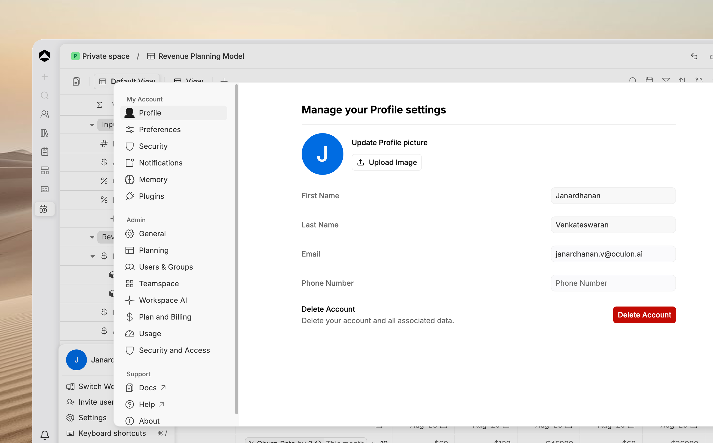

Personal settings live under **My Account** in Settings. Use them for options that apply to you rather than the whole workspace.

Workspace-wide admin controls remain under **Admin** (Workspace Owners only). See [Workspace settings](/concepts/settings-and-administration/workspace-settings).

<Frame caption="Profile settings">
  
</Frame>

## My Account categories

| Area | What you configure |
| :--- | :--- |
| **Profile** | Picture, first name, last name, email (with confirmation), delete account. Phone may appear disabled depending on account setup. |
| **Preferences** | Mode, theme, accent color, default home screen, timezone, time format, language |
| **Security** | Sign-in options, two-factor authentication, and sessions |
| **Notifications** | Activity, AI & Agents, Data & Models, Workspace & Billing preferences — see [Notifications](/concepts/settings-and-administration/personal-settings/notifications) |
| **AI** | Personal AI / memory options when available — see [Knowledge and memory](/concepts/ai-and-agents/knowledge-and-memory) |
| **Skills** | Personal skills library when available (placement vs Concepts Skills remains REVIEW) |
| **Connectors & MCP** | Personal/workspace connector access entry — see [Context and connections](/concepts/ai-and-agents/context-and-connections) |

## Preferences details

Confirmed preference controls include:

- **Mode** / **Theme**
- **Accent color**
- **Default home screen**
- **Timezone**
- **Time format**
- **Language**

## In this section

<Card title="Notifications" icon="bell" href="/concepts/settings-and-administration/personal-settings/notifications">
  Inbox alerts and notification preferences.
</Card>

## Related pages

- [Notifications](/concepts/settings-and-administration/personal-settings/notifications)
- [Workspace AI](/concepts/ai-and-agents/workspace-ai)
- [Workspaces](/concepts/workspace-and-collaboration/workspaces)
