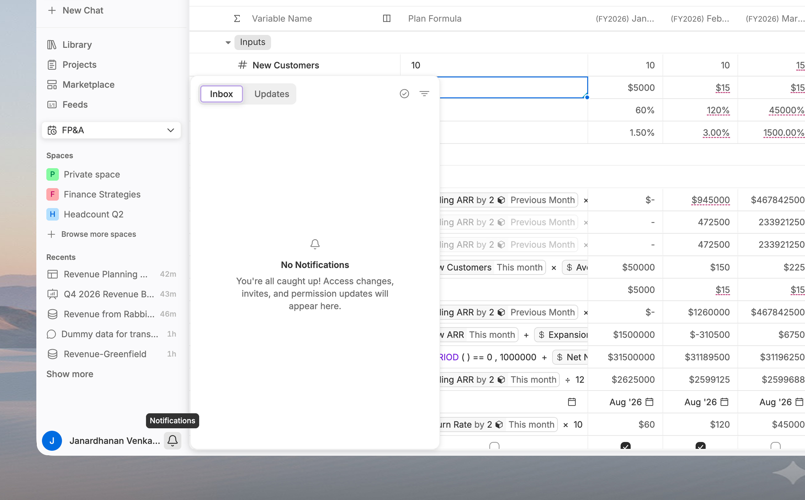

Notifications help you stay aware of comments, mentions, access changes, and invites without watching every resource continuously.

Oculon surfaces notifications in **Inbox**. Personal preference controls live under **My Account → Notifications**.

<Frame caption="Inbox">
  
</Frame>

## Inbox

Use Inbox to review recent alerts, open the related resource, and mark items read or archived.

Supported notification categories include events such as:

- **comment**
- **mention**
- **assignment**
- **status change**
- **access request**
- **access granted**
- **access revoked**
- **workspace invite**
- **role changed**

Exact actions available on an item depend on the notification type. For example, workspace invites can support accept or decline, and access requests can support approve or deny when you have permission.

## Notification preferences

Configure which alerts you want under **My Account → Notifications**. Prefer documenting the categories you actually receive in Inbox rather than assuming every preference maps one-to-one to every event type.

Older support docs that only say notifications are “coming soon” are outdated relative to Inbox.

## Keep Concepts and Settings distinct

- **Concepts** explains what notifications are for and which categories exist.
- **My Account → Notifications** is where you change personal delivery preferences.
- Workspace membership and sharing still control who can take access actions from a notification.

## Related pages

- [Comments and collaboration](/concepts/workspace-and-collaboration/sharing-and-permissions/comments-and-collaboration)
- [Users, guests and invitations](/concepts/settings-and-administration/users-guests-and-invitations)
- [Personal settings](/concepts/settings-and-administration/personal-settings)
