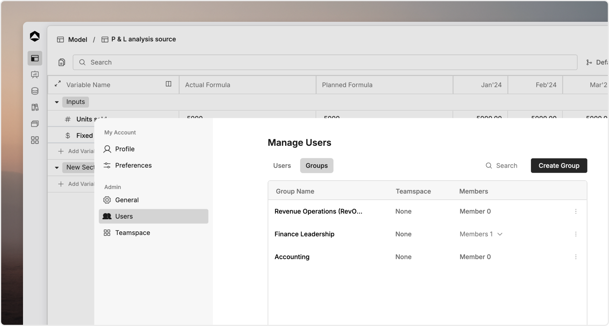

Groups help you scale access management without recreating the same permissions for every person. In Settings, groups live under **Users & Groups** alongside members.

This page covers groups and how they relate to access. Detailed security controls stay under [Security](/concepts/settings-and-administration/security).

## Creating and managing groups

<Frame caption="Groups in Settings">
  
</Frame>

1. Create a group.
2. Rename it to a stable business name (for example Finance Team).
3. Add workspace members.
4. Grant the group access to teamspaces or resources as needed.

## Sharing with groups

Resources such as models, boards, and Transactions can be shared with groups just like individual users. When you share a resource with a group and assign **View**, **Edit**, or **Full Access**, that permission applies to everyone currently in the group.

## Good group design

Create groups around stable business concepts such as Finance, RevOps, or Executive Review. Avoid temporary groups that mirror a one-time meeting unless the access need is truly temporary.

## Keep item access and workspace roles distinct

- Workspace roles decide who belongs in the environment and who can administer it.
- Space membership decides who belongs in a private or shared Space.
- Item permissions decide what someone can do on a specific model, board, view, or other resource.

For item-level role tables and inheritance detail, see [Roles and permissions](/concepts/workspace-and-collaboration/sharing-and-permissions/roles-and-permissions) and [Permission inheritance](/concepts/workspace-and-collaboration/sharing-and-permissions/permission-inheritance).

## Review group membership regularly

Review ownership and membership as part of onboarding and offboarding so access stays aligned with reality.

## Related pages

- [Users, guests and invitations](/concepts/settings-and-administration/users-guests-and-invitations)
- [Sharing and permissions](/concepts/workspace-and-collaboration/sharing-and-permissions)
- [Teamspaces and private space](/concepts/workspace-and-collaboration/teamspaces-and-private-space)
