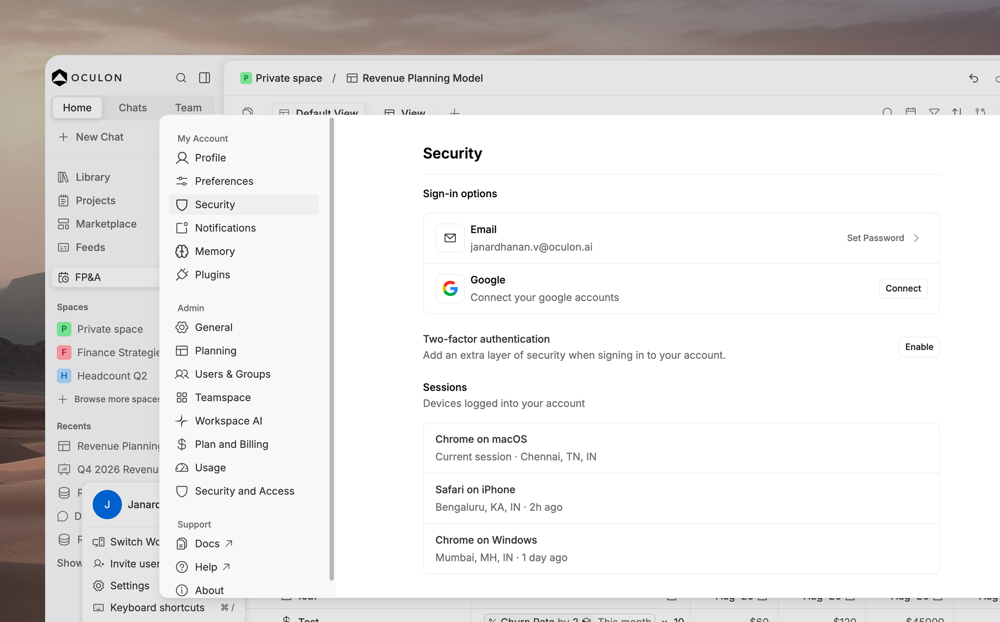

Security in Oculon spans personal sign-in controls and workspace join policy. Open Settings from the profile menu.

<Frame caption="My Account Security">
  
</Frame>

## Two security surfaces

| Surface | Where | Who |
| :--- | :--- | :--- |
| **My Account → Security** | Personal sign-in and sessions | Every user for their own account |
| **Admin → Security and Access** | Who can join the workspace and related controls | Workspace Owners |

Item sharing and inheritance are separate. See [Sharing and permissions](/concepts/workspace-and-collaboration/sharing-and-permissions) and [Roles and permissions](/concepts/workspace-and-collaboration/sharing-and-permissions/roles-and-permissions).

## My Account security

Confirmed personal controls include:

- **Sign-in options** such as email password set/reset and Google connect
- **Two-factor authentication** enable/disable
- **Sessions** controls such as log out

See also [Login methods](/concepts/settings-and-administration/security/login-methods).

## Security and Access (workspace)

Confirmed workspace controls include:

- Who can join: **Invite only** or **Approved domains**
- **Allowed email domains** (add domain; verified/unverified states)
- Domain access behavior such as **Automatically join as member** or **Request access**
- **Require two-factor authentication** for the workspace

These settings shape join posture. They do not replace item-level permissions on models, boards, or Transactions.

## Least privilege

Give people the smallest access scope that still lets them do their job. Keep Full Access on sensitive planning assets limited, and review join rules after major org changes.

## What is not documented as a current Settings surface

The following are **not** confirmed as generally available Settings pages in the current product overlay:

- Dedicated SSO / SAML / SCIM admin UI
- Dedicated audit log browser
- Impersonation / grant-access admin tools

If your organization needs centrally managed identity beyond the controls above, confirm availability with your Oculon plan and support channel rather than assuming SSO from older docs.

## In this section

<Columns cols={2}>
  <Card title="Login methods" icon="key-round" href="/concepts/settings-and-administration/security/login-methods">
    How people authenticate into Oculon.
  </Card>
  <Card title="Audit logs" icon="file-text" href="/concepts/settings-and-administration/security/audit-logs">
    Oversight expectations and current availability.
  </Card>
</Columns>

## Related pages

- [Workspace settings](/concepts/settings-and-administration/workspace-settings)
- [Workspace access and visibility](/concepts/workspace-and-collaboration/workspace-access-and-visibility)
- [Personal settings](/concepts/settings-and-administration/personal-settings)
