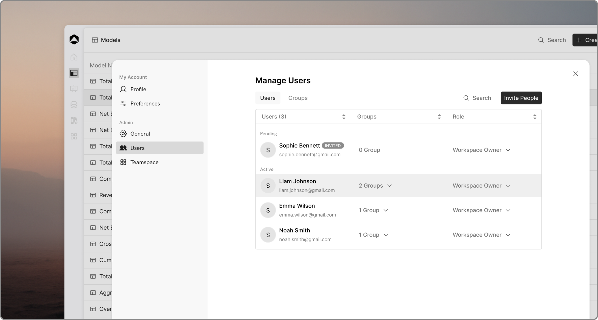
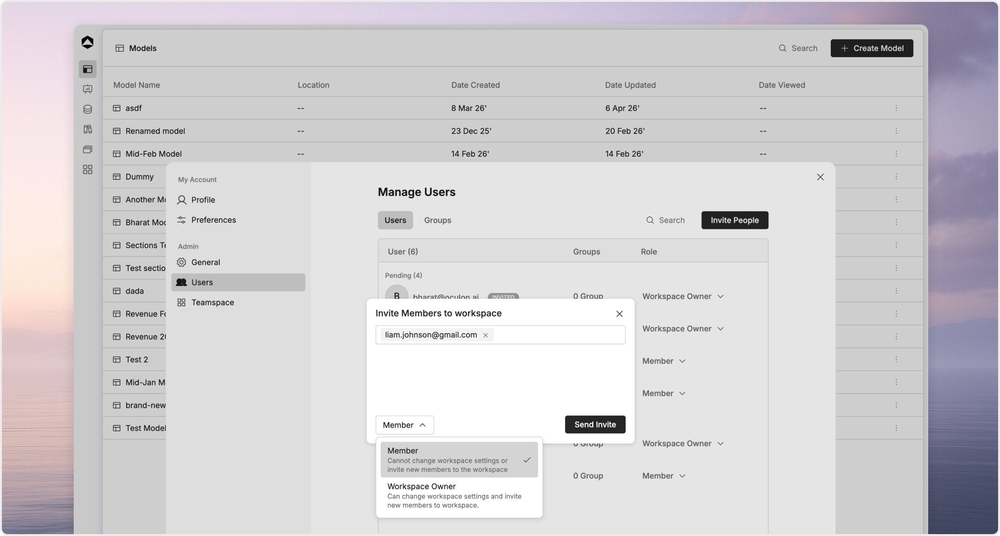

Member and invitation management is the foundation of secure collaboration. In product Settings, open **Users & Groups** to manage people in the workspace.

This page covers the conceptual access model for people entering the workspace. Item-level sharing still happens on each resource. See [Sharing and permissions](/concepts/workspace-and-collaboration/sharing-and-permissions).

## Managing members

<Frame caption="Workspace users list">
  
</Frame>

From the users list, owners can typically:

- update workspace roles
- view group membership
- remove members
- manage pending invites

## Workspace roles

Oculon workspace-level roles commonly include:

- **Workspace Owner** — full control over settings, members, and workspace resources
- **Member** — standard access to create and collaborate

Keep the role set small and clear. Too many slightly different roles are harder to audit.

## Invite users

<Frame caption="Invite users">
  
</Frame>

1. Open **Invite Users**.
2. Enter one or more email addresses.
3. Choose the appropriate access.
4. Submit the invite. Invites appear as **Pending** until accepted.

Admins and owners can revoke a pending invite before it is accepted.

## Guests

Use guests when someone needs limited collaboration on a defined slice of content rather than broad workspace participation. Prefer guests for temporary or external reviewers who should not receive full member access.

For audience-pattern guidance still, see [Members, guests, and groups](/concepts/settings-and-administration/users-guests-and-invitations).

## Prefer group-based scaling

When several people need the same access, place them in a group instead of managing every permission one by one. See [Roles and access](/concepts/settings-and-administration/roles-and-access).

## Related pages

- [Roles and access](/concepts/settings-and-administration/roles-and-access)
- [Sharing and permissions](/concepts/workspace-and-collaboration/sharing-and-permissions)
- [Workspaces](/concepts/workspace-and-collaboration/workspaces)
