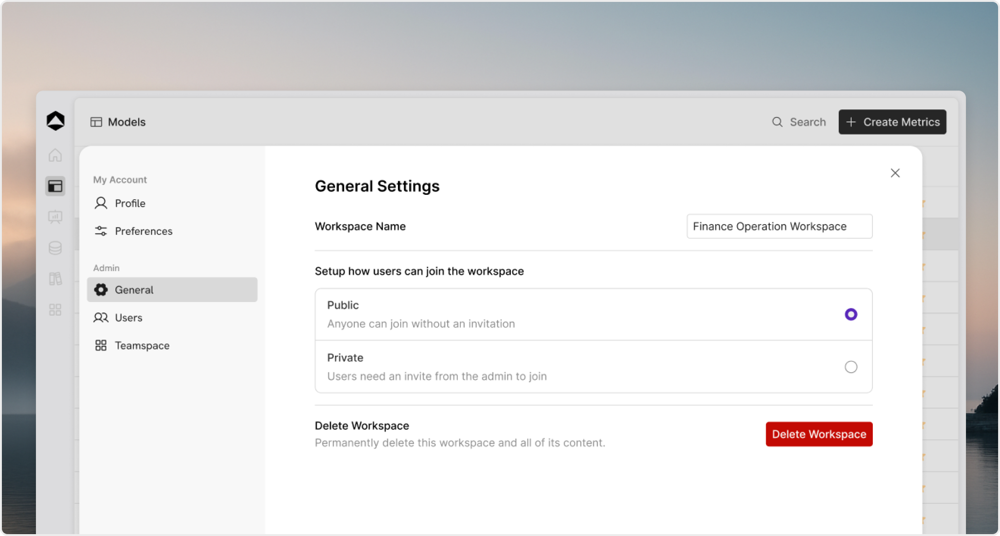

Workspace settings control how the environment is named, accessed, and governed. Open them from the profile menu → Settings. The **Admin** section is available to **Workspace Owners**.

<Frame caption="Workspace settings">
  
</Frame>

## Who can change workspace settings

| Audience | Access |
| :--- | :--- |
| **Workspace Owner** | Admin settings (General, Planning, Users & Groups, Teamspace, Workspace AI, Plan and Billing, Usage, Security and Access) |
| **Member** | My Account only; no Admin section |

## Admin settings categories

| Settings item | What it covers |
| :--- | :--- |
| **General** | Workspace name, workspace picture, Public/Private join radios, Delete Workspace |
| **Planning** | Planning defaults and currency defaults — see [Planning defaults](/concepts/settings-and-administration/workspace-settings/planning-defaults) |
| **Users & Groups** | Members, guests, invites, and groups — see [Users, guests and invitations](/concepts/settings-and-administration/users-guests-and-invitations) and [Roles and access](/concepts/settings-and-administration/roles-and-access) |
| **Teamspace** | Create and manage Spaces / teamspaces — see [Teamspaces and private space](/concepts/workspace-and-collaboration/teamspaces-and-private-space) |
| **Workspace AI** | Workspace-level AI policy — see [Workspace AI](/concepts/ai-and-agents/workspace-ai) |
| **Plan and Billing** / **Usage** | Plan and usage — see [Billing and usage](/concepts/settings-and-administration/billing-and-usage) |
| **Security and Access** | Who can join and workspace security expectations — see [Security](/concepts/settings-and-administration/security) |

## General settings

In **General** you can typically:

- Set the **Workspace Name** and workspace picture
- Choose whether the workspace join posture is **Public** or **Private**
- **Delete Workspace** (destructive; owners only)

Workspace membership and discovery also relate to [Workspace access and visibility](/concepts/workspace-and-collaboration/workspace-access-and-visibility) and Security and Access join rules.

## What this page does not cover

- Object-level sharing on models, boards, or views — see [Sharing and permissions](/concepts/workspace-and-collaboration/sharing-and-permissions)
- Personal profile and preferences — see [Personal settings](/concepts/settings-and-administration/personal-settings)
- Import/Export as a dedicated admin settings page (not present in Settings today; related alerts may appear under Notifications)

## Related pages

- [Planning defaults](/concepts/settings-and-administration/workspace-settings/planning-defaults)
- [Security](/concepts/settings-and-administration/security)
- [Billing and usage](/concepts/settings-and-administration/billing-and-usage)
- [Workspace AI](/concepts/ai-and-agents/workspace-ai)
