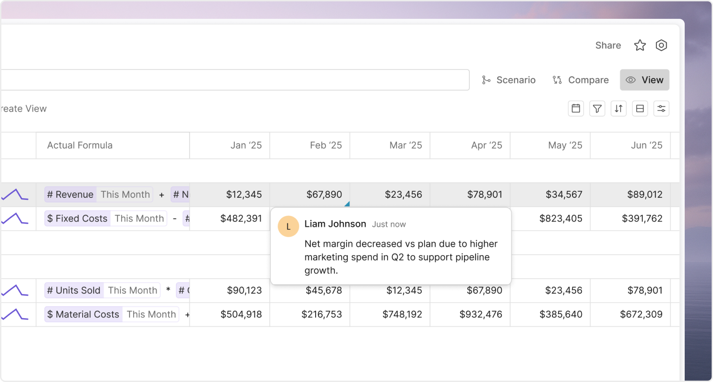

Comments are most useful when the discussion stays attached to the exact metric, assumption, or report being reviewed.

Comments are supported on planning and reporting surfaces such as models, boards, Transactions, and dimensions when you have access to those resources.

<Frame caption="Comments in Oculon">
  
</Frame>

## Use comments for decisions, not just reactions

Good comments move work forward. They explain what changed, what needs a response, or what decision is still open.

Use comments when you need to:

- ask for review on a specific metric or assumption
- explain why a value changed
- capture the business context behind a planning choice
- close the loop on an open question without leaving the model or board

## Comment on the smallest useful object

Keep the conversation close to the thing being discussed.

- Comment on the specific item under review, not only the broader page.
- Describe the business question, not just the symptom.
- Mention the assumption, time period, scenario, or filter context when it matters.

Mentions can notify people through Inbox when notifications are delivered for that event.

## Keep review cycles structured

Comments work best when they are paired with a clear review surface.

Useful patterns include:

- a named scenario for in-progress planning changes
- a shared view for one filtered slice
- a board review for decision-ready output

## Close loops when the work is done

- Resolve comments when the issue is closed.
- Add a final note if the decision changed the model or the expected next step.
- Start a new thread when the topic changes instead of overloading the old one.

## Related pages

- [Sharing and permissions](/concepts/workspace-and-collaboration/sharing-and-permissions)
- [Notifications](/concepts/settings-and-administration/personal-settings/notifications)
- [Scenario compare](/concepts/analysis-and-reporting/compare/scenario-compare)
