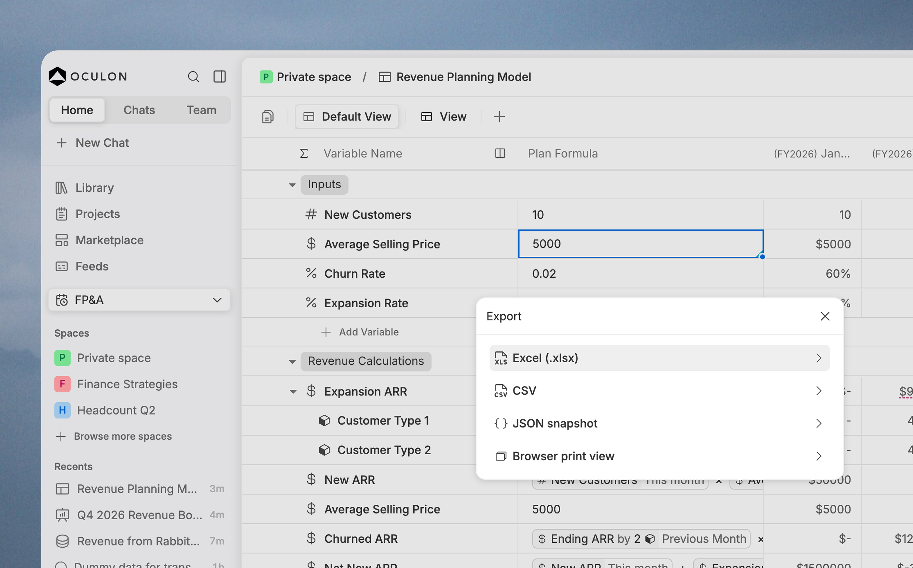

Exports are useful when people need a fixed snapshot or offline handoff rather than live access inside Oculon.

<Frame caption="Export formats">
  
</Frame>

## Availability

Exports are available only when export features are enabled for your workspace. If you do not see export controls in Share, the feature is not available in your environment.

## When to export

Export when the recipient needs:

- a fixed snapshot for offline analysis
- a board or table pack for a one-time review
- an audit or approval handoff that should not change after send

Prefer a live board, view, or published link when the recipient needs current data and repeat access.

## Protect context when data leaves Oculon

An exported number can lose the context that made it meaningful. Include enough framing for:

- the active scenario
- current filters
- the time range or reporting period
- whether the result came from a board, view, or model

## Recheck external risk each time

Before you send an export, confirm:

- the recipient really needs it outside the workspace
- the surface does not expose more detail than intended
- the exported result still matches the scenario and time context you mean to share

## Related pages

- [Publishing](/concepts/workspace-and-collaboration/sharing-and-permissions/publishing)
- [Sharing and permissions](/concepts/workspace-and-collaboration/sharing-and-permissions)
